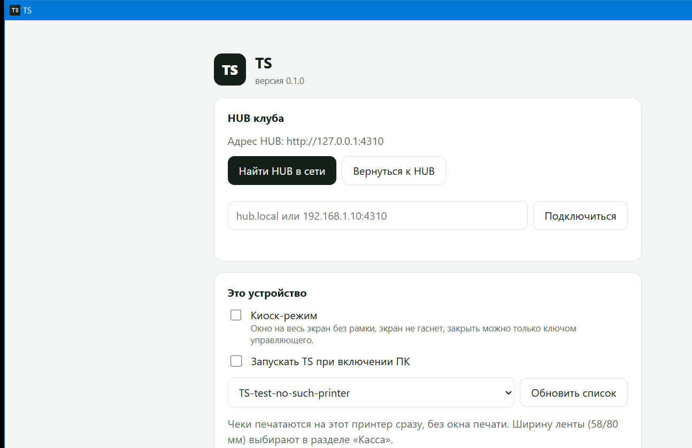

# TS

TS — система управления заведениями: учёт времени и мест с физическим управлением оборудованием, тарифы, персонал, касса и кассовые смены, бар и заказы, отчёты. Владелец сети видит и контролирует все филиалы из одного кабинета, а каждая точка работает автономно — даже без интернета.

Первый случай применения — **бильярдные клубы**: открытие и закрытие времени на столе с физическим включением лампы, тарифы по времени суток, официанты, кассовые смены. Дальше та же основа — для кафе, клубов и других заведений. Документация ниже описывает бильярдный случай.

> **Для следующих сессий (людей и ИИ-агентов):** сначала прочитай раздел [«Как продолжать работу»](#как-продолжать-работу) и [«Текущий статус»](#текущий-статус). План ниже — источник правды; после каждого этапа обновляй статус здесь же.

---

## Как это устроено

```
                 ┌──────────────── ОБЛАКО (этап 6) ─────────────────┐
                 │  Кабинет владельца: все клубы, отчёты, тарифы,   │
                 │  сотрудники, права. Компания → клубы → столы.    │
                 └───────────────▲──────────────────────────────────┘
                                 │ синхронизация (outbox, только исходящие события
                                 │ и входящие настройки; клуб работает без интернета)
┌──────────────────── КЛУБ ──────┴───────────────────────────────────────────┐
│  HUB — мини-ПК в клубе (apps/hub): API, база SQLite, правила, аудит        │
│     ▲                         ▲                          │                 │
│     │ LAN / Wi-Fi             │                          │ команды лампам  │
│  планшеты официантов,     касса (ПК кассира,             ▼                 │
│  экран зала (apps/web)    ККМ, терминал, QR)     контроллер реле (ESP32 / │
│                                                  Modbus) → лампы столов    │
└────────────────────────────────────────────────────────────────────────────┘
```

Главная идея: **в каждом клубе стоит локальный HUB**. Столы, лампы и касса работают через него, даже если пропал интернет. Облако нужно владельцу (сводка по филиалам, отчёты, настройки), но не нужно для того, чтобы открыть стол.

### Роли

Две стороны: **платформа TS** (владелец и его поддержка) продаёт TS **клиентам** — компаниям и сетям клубов. Клиентом управляет управляющий, он нанимает сотрудников своих филиалов. Подробно — «[Ключи доступа и иерархия](#ключи-доступа-и-иерархия)».

| Роль | Кто | Где действует | Что может |
|---|---|---|---|
| Владелец (`owner`) | владелец платформы TS | все клиенты | клиенты, их лицензии (срок, филиалы, модули), продление и блокировка, команда поддержки; в любом HUB — всё |
| Техподдержка (`tech`) | команда владельца | все клиенты | то же, кроме найма самой поддержки |
| Управляющий (`manager`) | клиент: компания, купившая TS | все филиалы компании | филиалы (в пределах лицензии), сотрудники и их роли, простые ключи, тарифы, настройки, отчёты |
| Сотрудники: администратор, старший смены, кассир, бармен, официант | люди управляющего | один филиал | по ролям; у человека может быть несколько ролей сразу (официант + кассир), права складываются |

### Ключевые правила (инварианты)

Эти правила уже закреплены в коде и тестах — не ломай их:

1. **Время считается с момента, когда лампа подтвердила включение**, а не с нажатия кнопки. Если контроллер не ответил — игра не началась, деньги не начисляются.
2. **Время останавливается в момент нажатия «Стоп»**, а не когда лампа подтвердит выключение: гости не платят за задержку оборудования.
3. **На столе может быть только одна живая игра** (`OPENING`, `ACTIVE` или `PAUSED`). Защита — и в коде, и уникальным индексом в базе.
4. **Каждая команда идемпотентна**: клиент присылает `Idempotency-Key`, повтор того же запроса (обрыв сети, двойное нажатие) возвращает тот же результат и ничего не дублирует.
5. **Тариф фиксируется в игре при открытии** (снимок). Изменение тарифа не меняет цену уже идущих игр.
6. **Деньги — целые числа в минимальных единицах** (тиыны/копейки). Никаких float.
7. **Каждое действие пишется в аудит** (кто, что, когда, данные) и в outbox для будущей синхронизации с облаком.
8. **HUB после перезапуска восстанавливает состояние**: идущие игры продолжают считаться, лампы приводятся к нужному состоянию, незавершённые команды досылаются.
9. **После «Стоп» стол сразу свободен**, а игра превращается в счёт «ожидает оплаты». Неоплаченные игры и счета видны кассиру; **с ними нельзя закрыть смену**.
10. **Пауза останавливает время и деньги**, лампа гаснет (или мигает — `pauseLamp` в тарифе). Возобновление — как открытие: время идёт снова только после подтверждения лампы. Лимиты пауз — в тарифе (`maxPauses`, `maxPauseMinutes`, по умолчанию 3 паузы / 30 мин): сверх лимита пауза не даётся (422), а пауза, затянувшаяся дольше бюджета, дальше считается как игра.
11. **Перенос на другой стол** не меняет тариф и не прерывает игру: промежуток между выключением старой лампы и подтверждением новой — неоплачиваемая пауза с причиной `transfer`.
12. **Деньги принимаются и возвращаются только при открытой кассовой смене.** Каждая оплата и возврат привязаны к смене; X/Z-отчёт и ожидаемые наличные считаются из этих записей, а не из итогов «на глаз».
13. **Картой и QR нельзя заплатить больше, чем к оплате**; сдача — только из наличных. Счёт оплачен, когда к оплате 0 — тогда его игры становятся `CLOSED`. Меньше — частичная оплата, счёт остаётся открытым.
14. **Отмена игры и возврат — только с причиной и подтверждением управляющего** (`approvedBy`), всё в аудите. Возврат — не больше, чем оплачено этим способом; наличный — не больше, чем есть в кассе. Отменить игру из счёта, по которому уже есть оплата, нельзя — сначала возврат. Отменить можно и игру на паузе — пауза закрывается вместе с игрой.
15. **Предоплаченная игра («на N минут») заканчивается в дедлайн = подтверждённый лампой старт + N минут игры.** Дедлайн хранится в базе (`prepaid_games.deadline_at`): после перезапуска HUB игра всё равно заканчивается в дедлайн, время простоя после него не начисляется. Пауза (своя, `transfer` или `power`) сдвигает дедлайн на длину неоплачиваемого промежутка — гость получает ровно свои N минут игры; на паузе таймер не срабатывает. За 5 минут игрового времени до конца — команда `BLINK` лампе. Остановка или отмена раньше срока снимает таймер. Оплаченная заранее игра после остановки сразу `CLOSED`; если она так и не началась — тревога «верните деньги» (возврат — обычный, с подтверждением). **Продление на N минут** (`POST /api/sessions/:id/extend`, право `table.open`, как у продажи предоплаты) сдвигает дедлайн ровно на N минут (паузы до и после работают как обычно) и заново взводит мигание за 5 минут. Цена — по тарифу игры с текущего дедлайна (`prepaidExtensionPrice`: разница цены длинной и оплаченной игры, без повторного минимума и бесплатных минут). Оплаченная заранее игра получает строку «Продление» (`EXTENSION`) в отдельном счёте — открытом счёте продлений этой игры или новом: сразу оплаченном (только при открытой смене и полной суммой) или открытом до оплаты на кассе (с ним нельзя закрыть смену, убрать строку нельзя). Игра с оплатой после остановки просто играет дольше и оплачивается по времени. Игру без лимита продлевать нечего.

### Нюансы, которые легко упустить

- **Защита от «своих».** Главная причина, по которой клубы покупают такие системы, — персонал включает свет друзьям без оплаты. Поэтому лампа должна питаться **только через реле системы**, выключатели на стене убираются, а датчик тока на линии лампы сообщает, горит ли она на самом деле. Свет без игры → тревога владельцу.
- **Контроллер не должен гасить свет сам**, если пропала связь с HUB или HUB перезагрузился: идёт игра, люди с киями. Реле держит последнее состояние; HUB при старте сверяет и досылает команды.
- **Отключение электричества.** После возврата питания время считается от реального начала игры; HUB должен быть на ИБП, контроллер — восстанавливать состояние после подачи питания. HUB следит за ИБП (NUT/apcupsd): на батарее — тревога, при желании клуба — автопауза игр; свет над столами от ИБП не питается, поэтому гости всё равно не играют.
- **Пропал интернет** — клуб работает полностью: столы, касса, лампы. Облако догоняет из outbox.
- **Тарифы по времени суток и дням недели**, игра через границу тарифа (день → вечер, через полночь) делится на отрезки. Окно «пт 22:00–06:00» относится к пятнице, даже когда уже наступила суббота.
- **Округление и минимум**: шаг тарификации (поминутно, по 5/10/15 мин), минимальное время, бесплатные первые минуты на отмену. Всё задаётся в тарифе, а не в коде.
- **Предоплаченное время** («на 1 час»): автоостановка по таймеру и мигание лампы за 5 минут до конца — гости понимают, что время заканчивается.
- **Перенос игры на другой стол**, продление, объединение и разделение счёта, частичная оплата, смешанная оплата (наличные + карта + Kaspi QR).
- **Отмены и возвраты** — только с причиной и подтверждением управляющего, всё в аудите. Скидки — по правам, с лимитом.
- **Фискализация (Казахстан):** онлайн-ККМ и ОФД — на каждую оплату нужен фискальный чек. Интеграция с ККМ — отдельный этап, требования нужно проверить юридически.
- **Часовой пояс клуба** хранится в настройках клуба (у сети могут быть филиалы в разных поясах).
- **Время HUB** — источник правды для начисления; планшеты могут врать часами, поэтому UI считает время от серверного.
- **Бэкапы** базы HUB каждый день + выгрузка в облако; обновления HUB без потери идущих игр.

---

## Структура репозитория

```
packages/domain   чистая бизнес-логика без ввода-вывода: тарифы, расчёт стоимости, счёт, оплата, кассовая смена
apps/hub          локальный сервер клуба: HTTP API, SQLite, лампы, аудит, идемпотентность
apps/web          экраны клуба (React + Vite): вход по ключу и роли, зал с планом, касса (счета, оплата, смена, печать),
                  заказы, сводка, тарифы, бар, сотрудники, журнал, оборудование (лампы, ИБП, ручной режим, симулятор),
                  настройки, кабинет владельца
apps/cloud        облако (Fastify): компании, клубы, владельцы, приём outbox, настройки вниз, отчёты
apps/cloud-web    кабинет владельца сети (React + Vite): все клубы, выручка, загрузка столов, тарифы
apps/desktop      приложение TS для ПК кассы и мини-ПК (Tauri 2, Rust): окно с интерфейсом HUB, киоск, тихая печать чеков,
                  автозапуск, установка HUB службой, автообновление; установщики .msi и .deb
scripts/local.mjs своя копия клуба (HUB + экраны) на отдельных портах и с отдельной базой
supabase/         публичное облако на Supabase: миграции (схема, RLS, отчёты RPC), Edge Functions sync/owner/notify, тесты на PGlite
deploy/           установка HUB в клубе: Linux (systemd, бэкапы, обновления с откатом), Windows, удалённая поддержка
docs/             регламенты: эксплуатация для управляющего (OPERATIONS_RU), инфраструктура (INFRASTRUCTURE_RU),
                  публичный доступ бесплатно — Supabase + Cloudflare/GitHub Pages (PUBLIC_DEPLOY_RU),
                  монтаж оборудования для электрика (INSTALL_HARDWARE_RU: щиток, реле, датчики, ключ ручного режима),
                  тестовый стенд ESP32 + реле + датчик тока + лампы 220 В (HARDWARE_TEST_BENCH_RU), фискализация (FISCAL_RU),
                  план приложений TS: браузер/PWA, приложение для ПК кассы и мини-ПК, мобильное приложение владельца (APP_PLAN_RU)
firmware/esp32-relay   прошивка контроллера ESP32: 8 реле, датчики тока, HTTP API, память состояния
```

Контракт HTTP между HUB и экранами (типы `HubState`, `SessionView`, `CheckView`, `HallLayout` …) лежит в `packages/domain/src/api.ts` и `hall.ts` — общий для обеих сторон. Протокол HUB ↔ облако и API кабинета владельца сети — в `packages/domain/src/cloud.ts` (там свои `ClubSnapshot` и `CloudLoginRequest`, чтобы не путать с настройками экрана и входом в клуб).

### Интерфейс (apps/web)

Одно приложение с разделами. На компьютере слева меню, на планшете оно сворачивается до иконок, на телефоне превращается в нижние вкладки. Тёмная и светлая тема, переключатель в верхней панели; там же часы клуба, тревоги, индикатор ИБП, индикатор облака («N в очереди»), плашка ручного режима и предупреждение «нет связи с HUB». Полный список страниц с правами — в разделе «Страницы и роли».

| Раздел | Что там | Файл |
|---|---|---|
| **Зал** | плитки дня, фильтры, **план зала** (столы нарисованы как настоящие, свет над играющими, таймер и сумма на сукне) или карточки; карточка стола умеет всё, что умеет HUB: открыть (в том числе «на N минут» и с предоплатой), стоп, **пауза / продолжить / перенос**, обратный отсчёт предоплаты, значки ручного режима и датчика тока; нажатие на стол открывает **карточку стола**: выбор тарифа с ценой «сейчас», разбивка суммы, предупреждение о смене тарифа, история стола за день; **редактор расстановки**: перетаскивание, поворот, метки (бар, касса, вход…), проверка места для кия 1,4 м | `sections/Hall.tsx`, `hall/*`, `TableCard.tsx`, `prepaid/*` |
| **Счета** (касса) | блок смены (открыть/закрыть, внесение/изъятие, X/Z, чеки смены, возврат), неоплаченные игры → «Оплатить» (наличные со сдачей, карта, QR, смешанная, частичная), отмена игры с подтверждением, печать чека и X/Z на 58/80 мм; игры за день с фильтрами по статусу и столу | `sections/Checks.tsx`, `cash/*`, `cash/print/*` |
| **Заказы** | товары из бара к идущей или неоплаченной игре, отмена с причиной | `pages/Orders.tsx` |
| **Сводка** | начислено, игры, средняя игра, загрузка; график по часам, по столам, по дням; сегодня / вчера / 7 дней | `sections/Stats.tsx` |
| **Тарифы** | недельная карта цен по получасам, правила, калькулятор игры | `sections/Tariffs.tsx` |
| **Бар и меню** | категории и товары: название, цена, остаток, активность | `pages/BarMenu.tsx` |
| **Сотрудники** | сотрудники, роли, PIN, ключи доступа | `pages/Staff.tsx` |
| **Журнал** | все действия человеческим языком, фильтры по типу и столу | `sections/Journal.tsx` |
| **Оборудование** | лампы и реле: как должно быть, как на деле, последняя команда, ошибка; «Мигнуть» у каждого стола; ручной режим; ИБП и автопауза; симулятор контроллера и ИБП | `sections/Equipment.tsx`, `Hardware.tsx` |
| **Настройки клуба** | клуб, столы, редактор тарифов, экран зала, правила | `pages/ClubSettings.tsx` |
| **Кабинет владельца** | выручка, загрузка, топ столов по данным этого клуба | `pages/Owner.tsx` |
| **Платформа** | макет страницы супер-админа | `pages/Platform.tsx` |

Каркас: `App.tsx` (таблица разделов и их компоненты), `Shell.tsx` (меню, верхняя панель с индикаторами, всплывающие окна, киоск-режим и `OfflineBanner`), `pwa.tsx` (установка приложения и обновление, см. «Установка на планшет и ПК»), `router.tsx` (`#/раздел?параметры`), `useHub.tsx` (состояние HUB, события в реальном времени с переподключением, сотрудник и `can()`, `run()` для команд с `Idempotency-Key`), `auth.ts` + `Login.tsx` (вход по ключу), `components.tsx` / `ui.tsx` (панель, плитки, значки статуса). Стили: `styles.css` (токены тем и карточки), `shell.css`, `plan.css`, `sections.css`, `app.css`, `cash/cash.css`, `prepaid/prepaid.css`, `cash/print/print.css`. Новый раздел = файл в `sections/` или `pages/` + строка в таблице маршрутов (`router.tsx`) + компонент в `App.tsx`.

Стек: Node.js 24 (TypeScript запускается напрямую, без сборки), Fastify, встроенный `node:sqlite`, React 19 + Vite. Тесты — встроенный `node --test`.

## Запуск

Нужен Node.js 24 (`.node-version`).

```bash
npm install
```

```bash
npm test
```

```bash
npm run dev:hub
```

```bash
npm run dev:web
```

HUB слушает `http://localhost:4310`, экраны — `http://localhost:5173` (Vite проксирует `/api` на HUB). При первом запуске HUB создаёт демо-клуб с 6 столами, двумя тарифами («Стандарт», «Снукер»), пятью демо-сотрудниками (владелец, управляющий, кассир, официант, платформа; PIN `1234`) и демо-меню бара. Данные лежат в `apps/hub/data/hub.db`; чтобы начать с чистого листа, останови HUB и удали этот файл. Настройки — переменные окружения, см. `.env.example` (файл `.env` в корне подхватывается сам).

При первом запуске HUB выдаёт ключи доступа демо-сотрудникам и пишет их в `apps/hub/data/first-run-keys.txt` (см. «Ключи доступа и иерархия») — вход на экране по ключу владельца.

В разделе **«Оборудование»** есть **симулятор контроллера**: можно отключить контроллер, задать задержку, сломать или «потерять» ответ на следующую команду, а у каждого реле — переключить датчик тока («руками» — свет включили мимо реле, «сгорела» — тока нет при игре) — так проверяются отказы без железа. Там же панель для монтажника и кассира: «Мигнуть» у каждого стола, ручной режим, ИБП (с симулятором при `HUB_UPS=simulator`).

Своя копия клуба, которая не мешает серверам разработки (HUB `4400`, экраны `5400`, база `apps/hub/data/local.db`):

```bash
npm run local
```

Вторая копия рядом — с другими портами и базой: `node scripts/local.mjs --hub-port=4610 --web-port=5610 --db=ui-check`.

Проверка типов: `npm run typecheck`. Сборка экранов: `npm run build -w @bills/web`.

### Настоящее оборудование (этап 5)

Контроллер выбирается переменной `HUB_LAMP_DRIVER` в `.env` (все настройки — в `.env.example`):

| Драйвер | Что это | Адрес канала стола (`lamp_channel`) |
|---|---|---|
| `simulator` | по умолчанию; контроллер в памяти HUB, панель «Симулятор ламп» | `relay-1` … `relay-N` |
| `esp32-http` | плата ESP32 с 8 реле и датчиками тока, прошивка `firmware/esp32-relay/`, HTTP в локальной сети | `esp32:192.168.1.50/3` (реле 3 на плате с этим IP; порт по умолчанию 80) |
| `modbus-tcp` | промышленный модуль реле Modbus TCP на DIN-рейку (FC05/FC01, датчики тока — дискретные входы FC02), своя реализация на `node:net` | `modbus:192.168.1.60:502/7` (реле 7 как напечатано на модуле; порт по умолчанию 502) |

Номер реле в адресе — с 1, как на корпусе; для Modbus драйвер сам переводит его в адрес катушки (`HUB_MODBUS_COIL_BASE`). Канал `relay-N` с настоящим драйвером попадает на реле N «платы по умолчанию» (`HUB_ESP32_HOST` / `HUB_MODBUS_HOST`), поэтому демо-база работает с железом без правок; стол на другой плате получает полный адрес (`UPDATE billiard_tables SET lamp_channel = 'esp32:192.168.1.51/2' WHERE name = 'Стол 2'`). Неверный адрес — ошибка команды и тревога, а не тихий отказ.

Что делает HUB поверх драйвера:
- **Опрос датчиков** каждые 10 с (`HUB_LAMP_POLL_MS`): реле и ток по каждому столу пишутся в `lamp_states` и видны на экране. Свет горит без игры дольше минуты (`HUB_LAMP_ALERT_AFTER_MS`) → тревога `LIGHT_WITHOUT_GAME`; игра идёт, а ток не течёт → `LAMP_DARK_DURING_GAME`. Реле, разошедшееся с нужным состоянием без команды в полёте, получает команду повторно (аудит `lamp.mismatch`). Пока команда в пути или включён ручной режим — ничего не судится.
- **Мигание** — команда `BLINK` в той же очереди `lamp_commands`: не трогает нужное состояние, ждёт позади `ON`/`OFF`, новая `ON`/`OFF` её отменяет. У ESP32 мигает прошивка, у Modbus — HUB щёлкает реле сам и возвращает как было. `POST /api/tables/:id/blink` — проверка монтажа с экрана; для предоплаченного времени (этап 2) готов метод `hub.blink(tableId, actor)`.
- **Ручной режим** (`POST /api/lamps/manual`): контроллер сломан — кассир включает режим с причиной, игры открываются сразу (`ACTIVE`, время с нажатия), помечаются `manual = 1` и в аудите, свет включают ключом в щитке, на экране жёлтая плашка. «Продолжить» после паузы и перенос в этом режиме тоже не ждут лампу — время идёт сразу. Отказы ламп в этом режиме пишутся в аудит без тревог. Выключить может только управляющий или владелец (право `lamps.manual_off` по токену; для актора без записи сотрудника — имя из `HUB_MANAGER_ACTORS`).
- **Контроллер никогда не гасит свет сам** при потере связи — это правило прошивки ESP32 и требование к модулю Modbus; состояние реле ESP32 хранится в NVS и восстанавливается после питания.
- **ИБП** (`HUB_UPS=nut://host:3493/ups` — Network UPS Tools, `apcupsd://host:3551` — apcupsd NIS, `simulator`; пусто — не следить): HUB раз в 5 с (`HUB_UPS_POLL_MS`) читает ИБП своими мини-клиентами на `node:net`. Переход на батарею → тревога `POWER_ON_BATTERY` и аудит; заряд ниже 20 % (`HUB_UPS_CRITICAL_PERCENT`) → `POWER_CRITICAL`; ИБП не отвечает три раза подряд → `UPS_UNREACHABLE`; возврат сети закрывает тревоги сам и пишет длительность отключения в аудит. Состояние — поле `power` в `/api/state` и `/api/health`, метрики `bills_power_*`, индикатор в шапке экрана зала. Настройка клуба `autoPauseOnPowerLoss` (`POST /api/power/settings`, по умолчанию выключена): при отключении света все идущие игры ставятся на паузу с причиной `power` (`SessionService.pauseAll`, миграция `008`) — это время не оплачивается и не тратит бюджет пауз тарифа; при возврате сети лампы включаются, и время идёт снова, как после «Продолжить» (`resumeAll`). Игры, которые персонал за это время продолжил или остановил сам, монитор не трогает.

Служебные команды HUB (без зависимости от `sqlite3`): `node apps/hub/src/cli.ts backup <папка>` — консистентная копия базы при работающем HUB, `restore <файл> --yes`, `check` — целостность, `version`, `ca init` / `ca show` — сертификаты для HTTPS (см. «Установка на планшет и ПК»).

## Бесплатный запуск

TS можно запустить для всей сети клубов **без платежей**: без аренды VPS, домена и магазинов приложений. Пошагово «для чайника» — [docs/FREE_SETUP_RU.md](docs/FREE_SETUP_RU.md).

- **Облако на мини-ПК главного клуба.** `install.sh --with-cloud` ставит рядом с HUB службу `bills-cloud` (облако + кабинет владельца на порту 4320, база SQLite `/var/lib/bills/cloud.db`, без PostgreSQL); ночной таймер бэкапов копирует и её базу. Данные лежат в клубе, то есть в Казахстане, — это заодно выполняет требование закона РК о хранении персональных данных.
  ```bash
  curl -fsSL https://raw.githubusercontent.com/ansa-music/billS/main/deploy/linux/install.sh | sudo bash -s -- --with-cloud
  sudo bills cloud init --company "Моя сеть" --email owner@example.kz      # владелец, печатает пароль
  sudo bills cloud add-club --name "Клуб «Центр»" --connect                # клуб + подключение этого HUB
  ```
- **Доступ снаружи.** Рекомендуемый — Tailscale (`sudo bills tailscale`, по желанию `--https`): бесплатная частная сеть, кабинет видят только устройства владельца и HUB других клубов, в интернет ничего не открыто. Альтернатива — Cloudflare Tunnel (`sudo bills tunnel quick` — временный адрес `*.trycloudflare.com` для показа; `sudo bills tunnel token <ТОКЕН>` — постоянный адрес на своём домене). Запасной — бесплатное имя DuckDNS + HTTPS через Caddy (`sudo bills duckdns --domain … --token … --https`, нужен «белый» IP).
- **Другие клубы** получают ключ `sudo bills cloud add-club --name "…"` на главном мини-ПК и подключаются `sudo bills connect-cloud --url http://<имя-в-tailscale>:4320 --hub-id … --key …` (Windows — `deploy/windows/connect-cloud.ps1`).
- **Приложения без магазинов.** Страница «Скачать приложение» в кабинете (`#/apps`) и на экранах клуба раздаёт файлы из GitHub Releases: Android — APK напрямую, ПК — установщик, iPhone — кабинет через Safari «На экран „Домой“» (PWA).
- **Платное — только при росте:** Google Play $25 один раз, Apple $99 в год, VPS в Казахстане — когда сеть вырастет и кабинет должен работать независимо от главного клуба.

## Установка в клубе

Эксплуатация — этап 8, всё лежит в `deploy/` и `docs/`:

| Что | Где |
|---|---|
| Бесплатный режим: облако на мини-ПК клуба, Tailscale / Cloudflare Tunnel / DuckDNS, приложения без магазинов | [docs/FREE_SETUP_RU.md](docs/FREE_SETUP_RU.md) |
| Linux (Ubuntu Server LTS, основной вариант): установка одной командой, служба systemd, ночные бэкапы, обновление с автооткатом, восстановление | [deploy/linux/README.md](deploy/linux/README.md) |
| Мини-ПК «вставил флешку — работает»: образ Debian с TS, запись на флешку, мастер `http://<ip>:4310/setup` | [docs/MINIPC_RU.md](docs/MINIPC_RU.md) |
| Windows (запасной вариант): Планировщик вместо службы, бэкапы, обновление, вариант с NSSM | [deploy/windows/README.md](deploy/windows/README.md) |
| Удалённая поддержка без открытия HUB в интернет: Tailscale или WireGuard, что открыть, регламент | [deploy/linux/remote-support.md](deploy/linux/remote-support.md) |
| Регламент для управляющего: чек-лист перед сменой, отключение света, HUB не отвечает, восстановление за час, обновления, мониторинг | [docs/OPERATIONS_RU.md](docs/OPERATIONS_RU.md) |
| Железо, сеть, свет и данные простыми словами | [docs/INFRASTRUCTURE_RU.md](docs/INFRASTRUCTURE_RU.md) |

Коротко: на мини-ПК с Ubuntu — `curl -fsSL https://raw.githubusercontent.com/ansa-music/billS/main/deploy/linux/install.sh | sudo bash`, дальше команда `bills` (`status`, `logs`, `update`, `backup`, `restore`, `check`, `health`). База — `/var/lib/bills/hub.db`, копии — `/var/lib/bills/backups/`, конфиг — `/etc/bills/hub.env`. Обновление без потери игр: миграции применяются к старой базе, HUB восстанавливает идущие игры (тест `apps/hub/test/migrations.test.ts`).

### Облако и кабинет владельца

```bash
npm run dev:cloud
```

```bash
npm run dev:cloud-web
```

Облако слушает `http://localhost:4320`, кабинет — `http://localhost:5180` (Vite проксирует `/api` на облако). При первом запуске облако создаёт демо-сеть: владелец `owner@demo.kz` / `demo1234`, два клуба и по одному HUB с ключами `demo-hub-key-1` (`HUB_ID=hub-demo-1`) и `demo-hub-key-2` (`HUB_ID=hub-demo-2`). Чтобы подключить локальный HUB к облаку, в `.env` задай `CLOUD_URL=http://127.0.0.1:4320`, `CLOUD_API_KEY=demo-hub-key-1`, `HUB_ID=hub-demo-1` и перезапусти HUB. Без `CLOUD_URL` HUB работает автономно. В разработке и тестах облако хранит данные в SQLite (`apps/cloud/data/cloud.db`); для продакшена задаётся `CLOUD_DATABASE_URL` (PostgreSQL), см. `apps/cloud/README.md`.

### HTTP API HUB

| Метод | Путь | Что делает |
|---|---|---|
| GET | `/api/state` | всё для экрана: клуб и его настройки, тарифы, столы с играми и лампами, неоплаченные игры, открытые счета и смена, заказы бара, тревоги, ручной режим, ИБП (`power`), облако (`sync`) |
| GET | `/api/events` | SSE: `changed` при любом изменении (экраны перечитывают данные), `ping` раз в 15 с (замолчал — экран переподключается) |
| GET | `/api/hall` | план зала: размеры, где стоит каждый стол, метки; `saved: false` — расставлено автоматически |
| PUT | `/api/hall` | сохранить план (проверяются все столы, границы зала, повороты 0/90) |
| GET | `/api/sessions?from=&to=` | игры, пересекающие период (мс), включая идущие, с паузами — для счетов и сводки |
| GET | `/api/journal?category=&tableId=&before=&limit=` | журнал действий страницами, новые сверху |
| GET | `/api/lamps` | лампы: как должно быть, как на деле, последняя команда |
| POST | `/api/tables/:tableId/open` | открыть стол, тело `{ "tariffId"?: string, "prepaidMinutes"?: number }`; с `prepaidMinutes` (5–720) HUB сам остановит игру через N минут игры |
| POST | `/api/tables/:tableId/open-prepaid` | открыть «на N минут» и сразу принять всю оплату: `{ minutes, amount, parts, tariffId?, quotedAt? }` → `{ session, check, applied, change }`; `amount` — цена, показанная гостю (`prepaidPrice`), иначе `409 PREPAID_PRICE_CHANGED`; меньше цены — `422 PREPAID_NOT_FULLY_PAID` |
| POST | `/api/sessions/:sessionId/stop` | остановить игру (до подтверждения лампы — отмена без оплаты; на паузе — счёт на момент паузы; оплаченная заранее — сразу `CLOSED`) |
| POST | `/api/sessions/:sessionId/pause` | пауза: время и сумма замирают, лампа гаснет/мигает; 422 `PAUSE_LIMIT`, если лимит тарифа исчерпан |
| POST | `/api/sessions/:sessionId/resume` | продолжить: лампа включается, время идёт после её подтверждения (в ручном режиме — сразу); повтор во время включения — без ошибки |
| POST | `/api/sessions/:sessionId/transfer` | перенести игру на свободный стол, тело `{ "toTableId": string }`; 409, если стол занят |
| POST | `/api/tables/:tableId/blink` | мигнуть лампой стола, тело `{ "times"?: 1–10 }` (по умолчанию 3) — проверка монтажа; ответ 202 с `commandId` |
| GET | `/api/power` | ИБП: `{ configured, source, reachable, onBattery, chargePercent, runtimeSeconds, onBatterySince, critical, settings }` |
| POST | `/api/power/settings` | настройка клуба `{ "autoPauseOnPowerLoss": true }` — ставить игры на паузу при отключении света |
| GET/POST | `/api/dev/ups` | симулятор ИБП: GET всегда `200` — `{ configured: false }` без симулятора, иначе `{ configured: true, onBattery, chargePercent, runtimeSeconds, unreachable }`; POST только при `HUB_UPS=simulator` |
| GET | `/api/lamps/manual` | состояние ручного режима `{ enabled, reason, since, by }` |
| POST | `/api/lamps/manual` | включить `{ "enabled": true, "reason": "…" }` / выключить `{ "enabled": false }` (только управляющий и выше, 403 иначе) |
| POST | `/api/alerts/:alertId/resolve` | отметить тревогу принятой |
| POST | `/api/sessions/:sessionId/cancel` | отменить идущую или неоплаченную игру, тело `{ reason, approvedBy }` |
| POST | `/api/checks` | счёт гостя `{ sessionIds: string[], orderIds?: string[] }`: остановленные игры вместе с их открытыми заказами бара (строки `ORDER`: товар, кол-во, цена, сумма); `orderIds` — заказы без игры (после предоплаты или отменённой игры) |
| GET | `/api/checks/:checkId` | счёт: строки, скидка, итог, оплаты, к оплате |
| POST | `/api/checks/:checkId/items` | добавить игру в счёт, `{ sessionId }` |
| POST | `/api/checks/:checkId/items/:itemId/remove` | убрать строку (пока по счёту нет оплаты); пустой счёт → `VOID` |
| POST | `/api/checks/:checkId/discount` | скидка `{ discount: { kind: "PERCENT" \| "AMOUNT", value, reason } \| null }` |
| POST | `/api/checks/:checkId/pay` | оплата `{ parts: [{ method: "CASH" \| "CARD" \| "QR", amount }] }` — смешанная и частичная; ответ `{ check, change, remaining }` |
| POST | `/api/checks/:checkId/refund` | возврат `{ method, amount, reason, approvedBy }` |
| POST | `/api/shifts/open` | открыть смену с разменом `{ openingFloat }` |
| POST | `/api/shifts/:shiftId/cash` | внесение/изъятие `{ kind: "DEPOSIT" \| "WITHDRAWAL", amount, reason }` |
| GET | `/api/shifts/:shiftId/report` | X-отчёт открытой смены или сохранённый Z-отчёт закрытой |
| GET | `/api/shifts/:shiftId/checks` | счета с оплатами и возвратами этой смены |
| POST | `/api/shifts/:shiftId/close` | закрыть смену `{ countedCash, note? }` → `{ shift, report }` (Z); `409 UNPAID_CHECKS`, если есть неоплаченное |
| GET/POST | `/api/dev/lamps` | симулятор ламп (только при `HUB_LAMP_DRIVER=simulator`): задержка, отказы, датчик тока `light: { channel, on }`, `poll: true` |
| GET | `/api/tls` | HTTPS: включён ли, отпечаток и сроки сертификатов, адреса страницы `/ca` для QR-кода (право `equipment.view`) |
| GET | `/ca`, `/ca.crt`, `/ca.pem` | без входа: страница установки сертификата клуба, сам корневой сертификат (DER для Android и Windows, PEM); при `HUB_HTTP_PORT` отдаются и по обычному HTTP |
| GET | `/api/health` | здоровье для мониторинга: версия и git-коммит, uptime, размер базы, свободное место, последний бэкап, ИБП (`power`) |
| GET | `/metrics` | метрики Prometheus: игры идут/ждут оплаты, открытые тревоги, очередь ламп, outbox, бэкап, диск, ИБП (`bills_power_*`) |

Суммы в API — целые минимальные единицы (тиыны: `2000_00` = 2000 ₸). Ошибки — `{ "error": { "code", "message" } }`: `401` — нет или истёк токен, `403` — не по роли, `409` — состояние не позволяет (смена не открыта, счёт уже оплачен), `422` — нарушено денежное правило (переплата картой, возврат больше оплаченного, нет причины или подтверждения).

Остальные маршруты — по областям, каждая в своём файле (`apps/hub/src/http/routes/*.ts`; план зала, журнал, игры за период и лампы — в `http/hall-routes.ts`; касса — в `http/money-routes.ts`):

| Область | Маршруты | Файл |
|---|---|---|
| Настройки клуба | `GET /api/club`, `POST /api/club`, `POST /api/tables`, `POST /api/tables/:id/update`, `POST /api/tables/reorder`, `POST /api/tariffs`, `POST /api/tariffs/:id/update` | `routes/settings.ts` |
| Бар и заказы | `GET /api/bar/catalog`, `POST /api/bar/categories[/:id/update]`, `POST /api/bar/products[/:id/update]`, `POST /api/sessions/:id/orders`, `GET /api/sessions/:id/orders`, `POST /api/orders/:id/cancel` | `routes/bar.ts` |
| Вход, ключи, лицензия | `POST /api/auth/login` (`429 LOGIN_LOCKED` с `retryAfterMs`), `GET /api/auth/me` (с `license`), `POST /api/auth/logout`, `GET /api/auth/attempts?limit=&before=` (журнал попыток), `GET/POST /api/staff/:id/keys` (сотруднику — простой ключ, можно свои 6 цифр `key`: `422 KEY_WEAK`, `409 KEY_TAKEN`), `POST /api/keys/:id/revoke`, `GET /api/license`, `POST /api/license` (`422 LICENSE_INVALID`) | `http/auth.ts` |
| Сотрудники и аудит | `GET /api/staff`, `POST /api/staff[/:id/update]`, `POST /api/staff/:id/verify-pin`, `GET /api/audit?actor=&tableId=&action=&from=&to=&limit=&before=` — сырой аудит с фильтром по сотруднику и типу действия (экран «Журнал» читает `/api/journal`) | `routes/staff.ts` |
| Кабинет владельца | `GET /api/reports/summary?date=YYYY-MM-DD` | `routes/reports.ts` |

Типы запросов и ответов — в `packages/domain/src/api.ts`. Все POST и PUT требуют заголовок `Idempotency-Key` (8–200 символов), проходят через `runCommand` (`http/command.ts`) и пишут аудит. Кто действует — сотрудник из токена сессии (`Authorization: Bearer`, см. «Ключи доступа»); заголовок `X-Actor` больше не является источником правды (в тестах HUB собирается с `trustActorHeader`, в проде — никогда).

Каждый маршрут закрыт правом из `permissions.ts`: GET — через `guard(action)` в `preHandler`, POST/PUT — пятым аргументом `runCommand`. Проверка — `decide(roles, action, лицензия)`: сначала роль (права набора ролей складываются), потом лицензия филиала. Без токена — `401 UNAUTHORIZED`, не по роли — `403 FORBIDDEN`, лицензия кончилась или приостановлена — `403 LICENSE_READ_ONLY`, модуль не куплен — `403 LICENSE_MODULE_OFF` (в `message` — что сказать человеку). Владелец платформы и техподдержка могут всё и лицензией не ограничены; управляющий — всё, кроме дел платформы. Сотрудники:

| Право | Роли сотрудников (плюс управляющий) | Маршруты | При «только чтении» |
|---|---|---|---|
| `hall.view` | все | `GET /api/state`, `/api/hall`, `/api/sessions`, `/api/power`, `/api/lamps/manual` | работает |
| `table.open` | официант, кассир, старший, администратор | открыть стол (и `open-prepaid`) | **нельзя** |
| `table.continue` / `table.stop` | официант, кассир, старший, администратор | пауза, продолжить, перенести / стоп | работает — идущие игры доигрываются |
| `hall.edit` | администратор | `PUT /api/hall` | нельзя |
| `alert.resolve` | кассир, старший, администратор | `POST /api/alerts/:id/resolve` | работает |
| `checks.view` | кассир, старший, администратор | `GET /api/checks/:id`, `/api/shifts/:id/report`, `/api/shifts/:id/checks` | работает |
| `check.edit`, `payment.take`, `game.cancel` | кассир, старший, администратор | счёт, `/pay`, `/refund` (подтверждение — полем `approvedBy`, проверяется доменом), `POST /api/sessions/:id/cancel` | работает — игры оплачиваются |
| `discount.apply`, `refund.approve`, `cancel.approve` | старший, администратор | `/discount`, подтверждения | работает |
| `shift.open` / `shift.close` / `shift.cash` | кассир, старший, администратор | смена | работает |
| `order.create` / `order.cancel` | все / кассир, бармен, старший, администратор | заказы бара (модуль «бар») | нельзя / работает |
| `catalog.view` / `catalog.edit` | все / бармен, администратор | меню бара (модуль «бар») | работает / нельзя |
| `lamp.blink`, `lamps.manual_off` / `power.edit` | старший, администратор / администратор | мигнуть, выключить ручной режим, автопауза (модуль «оборудование») | мигнуть и настройка — нельзя |
| `lamps.manual` | кассир, старший, администратор | включить ручной режим (с причиной) | работает |
| `equipment.view` | старший, администратор | `GET /api/lamps`, `GET /api/tls` (модуль «оборудование») | работает |
| `audit.view` | старший, администратор | `GET /api/journal`, `GET /api/audit` | работает |
| `settings.view`, `tables.edit`, `tariffs.edit`, `display.edit`, `rules.edit` | администратор | настройки | смотреть — да, менять — нет |
| `club.edit` | только управляющий | название, часовой пояс, валюта | нельзя |
| `staff.view` / `staff.edit` | администратор / только управляющий | сотрудники, ключи, попытки входа | смотреть — да, менять — нет |
| `reports.view` | администратор | `GET /api/reports/summary` | работает |
| `license.view` / `license.install` | только управляющий | `GET /api/license` (видит каждый вошедший), `POST /api/license` | работает |

Публичны (без токена) только `/api/health`, `/metrics`, `/api/auth/login`, `/api/events` (SSE: браузер не может послать заголовок, а поток несёт лишь «что-то изменилось» без данных), `/api/dev/*` (симуляторы), сертификат клуба (`/ca`, `/ca.crt`, `/ca.pem`) и сам собранный экран (`/`, `/assets/*`). Синхронизация с облаком — исходящая (HUB сам ходит в облако), входящих маршрутов у HUB нет.

### Ключи доступа и иерархия

TS продаётся компаниям: **платформа** (владелец TS и его поддержка) заводит **клиента** и выдаёт ему **лицензию**, **управляющий** клиента заводит филиалы и **сотрудников**, сотрудники входят **простым ключом** только в своём филиале.

| Роль | Кто это | Ключ | Где действует | Что может |
|---|---|---|---|---|
| Владелец (`owner`) | владелец платформы TS | длинный `OWNER-XXXX-XXXX-XXXX-XXXX` | кабинет платформы в облаке; любой HUB любого клиента | клиенты и лицензии (создать, продлить, изменить лимиты и модули, заблокировать), ключи управляющих, команда поддержки; в HUB — всё, лицензия его не ограничивает |
| Техподдержка (`tech`) | команда владельца | длинный `TECH-…` | как у владельца | то же, кроме найма поддержки (`platform.staff`) |
| Управляющий (`manager`) | клиент — компания или сеть клубов, купившая TS | длинный `MGR-…` в HUB; в облачном кабинете — email и пароль | все филиалы своей компании | филиалы (в пределах лицензии), сотрудники и их роли, простые ключи, тарифы, настройки, отчёты, вставить лицензию в HUB |
| Администратор (`admin`) | сотрудник | простой, 6 цифр | один филиал | настройки клуба, тарифы, план зала, меню, оборудование, журнал, отчёты; видит сотрудников |
| Старший смены (`senior`) | сотрудник | простой | один филиал | всё кассира + скидки, возвраты и отмены, выключение ручного режима, журнал |
| Кассир (`cashier`) | сотрудник | простой | один филиал | смена, счета и оплата, столы, тревоги |
| Бармен (`bartender`) | сотрудник | простой | один филиал | заказы и меню бара |
| Официант (`waiter`) | сотрудник | простой | один филиал | открыть, поставить на паузу и остановить стол, заказы из бара |

У сотрудника может быть **несколько ролей сразу** (официант + кассир): роли хранятся набором (`staff.roles`), права — объединение (`can(roles, action)`). Владелец, техподдержка и управляющий — роли «сами по себе», с другими не совмещаются (`normalizeRoles`).

**Кто кого назначает** (`ASSIGNABLE_ROLES`, `canAssignRoles`): владелец → кого угодно; техподдержка → управляющих и сотрудников; управляющий → сотрудников своих филиалов; сотрудники никого не нанимают и ключей не выдают. Свои роли изменить и себя уволить нельзя; последнего управляющего убрать нельзя.

**Длинный ключ** — секретная строка, префикс называет роль (`OWNER`, `TECH`, `MGR`), остальное случайно, без похожих символов 0/O/1/I. Хранится хэшем sha256. Ключи платформы и управляющих облако раздаёт всем HUB, где они нужны (платформа — всем, управляющий — HUB своей компании).

**Простой ключ** сотрудника — 6 цифр, удобно набрать на планшете (на экране входа — цифровая клавиатура). Он действует **только в одном филиале**:
- хэш берётся от id филиала и цифр (`shortKeyHashInput(clubId, key)`): те же 6 цифр в другом филиале — другой хэш, а хэш, скопированный из базы одного HUB в другой, не подходит;
- HUB хранит ключи только своего филиала, облако при синхронизации отдаёт HUB только ключи этого филиала (`GET /sync/access`);
- ключ уникален внутри филиала; слабые (`111111`, `123456`, `121212`…) не выдаются; управляющий задаёт срок, меняет и отзывает ключ — отзыв сразу гасит все сессии с него.

**Защита от перебора.** 5 ошибок с одного IP — пауза (название устройства задаёт сам планшет, поэтому оно только пишется в журнал и счётчик не сбрасывает) 30 с, дальше каждая ошибка удваивает её, до 30 минут (`LOGIN_THROTTLE`, `loginLockMs`); во время паузы не принимается даже верный ключ, ответ `429 LOGIN_LOCKED` с `retryAfterMs`. Если по филиалу за час набралось 50 ошибок со всех устройств, простые ключи в нём на 5 минут не принимаются совсем. Каждая попытка — в журнале попыток (`GET /api/auth/attempts`: время, результат, устройство, IP; сам ключ не пишется), входы и выдача ключей — в аудите.

При входе (`POST /api/auth/login`) ключ меняется на токен сессии (30 дней, продлевается при использовании; хранится хэшем), который экраны шлют как `Authorization: Bearer …`.

#### Лицензия

Владелец платформы задаёт клиенту лицензию: **срок** (пробный 3 или 7 дней, N месяцев или до даты), **сколько филиалов** (1, 2, …), при желании — **сколько столов и сотрудников** в филиале, **модули** (бар, облако, оборудование). Облако подписывает её ключом платформы (Ed25519) и раздаёт всем HUB клиента; HUB проверяет подпись встроенным публичным ключом (`packages/domain/src/license.ts`), поэтому управляющий не может продлить или расширить лицензию правкой своей базы — изменённый байт ломает подпись, а HUB перепроверяет сохранённую лицензию при каждом старте. Лицензия перечисляет HUB, на которых действует (`hubIds`), — ту же лицензию на лишнем HUB не запустить. Без интернета HUB работает по сохранённой лицензии до её даты; расхождение часов HUB и облака до 15 минут допускается, а перевод часов назад не возвращает истёкший доступ (HUB помнит самое позднее время, которое видел).

| Состояние | Что видно | Что работает |
|---|---|---|
| действует | — | всё по ролям |
| осталось 3 дня и меньше | жёлтая плашка «Лицензия заканчивается через N дн.» | всё |
| последний день | жёлтая плашка «заканчивается сегодня» | всё |
| истекла, приостановлена владельцем, нет лицензии, подпись не сходится, лицензия другого HUB | красная плашка «Только чтение» | смотреть всё; идущие игры доигрываются, останавливаются и **оплачиваются**, смена закрывается; новые игры, заказы, правки настроек и сотрудников — `403 LICENSE_READ_ONLY`. Данные не удаляются |

Продлевает владелец платформы в своём кабинете — новая подпись доезжает до HUB при следующей синхронизации. HUB без облака: владелец копирует подписанную лицензию из кабинета, управляющий вставляет её в «Настройки клуба» → «Лицензия» (`POST /api/license`). Боевой ключ подписи — секрет `LICENSE_SIGNING_KEY` облака; в разработке и тестах облако подписывает dev-ключом из репозитория, а HUB принимает его только с `HUB_LICENSE_DEV_KEY=1`. Проверку лицензий на HUB включает `HUB_LICENSE=enforce` (по умолчанию), `off` — для разработки и демо.

**Первый ключ.** На свежем HUB без облака, если ни у кого нет рабочего длинного ключа, HUB выдаёт стартовый ключ техподдержки и записывает его в `first-run-keys.txt` рядом с базой (`apps/hub/data/`) и в лог — им установщик вставляет лицензию и заводит управляющего. HUB, подключённый к облаку, получает людей, ключи и лицензию оттуда.

**Демо.** Для презентаций и пробы клиентам ключи демо — 4 цифры, их можно продиктовать вслух: `0000` — владелец платформы, `1111` — управляющий (клиент с пробной лицензией), `2222` — старший смены (касса), `3333` — официант, `4444` — официант + кассир (несколько ролей). На экране входа демо они показаны крупными кнопками «Войти как …» — одно нажатие, без ввода; пробелы не важны. Лимит попыток в демо мягче (20 ошибок, пауза до 30 с), чтобы презентацию не заблокировало. Такие ключи принимает только демо-HUB (`HUB_DEMO=1` или демо в браузере): боевой HUB отклоняет любой 4-значный ключ сразу (`isDemoKeyShape`, тест в `apps/hub/test`).

### Страницы и роли

Приложение `apps/web` — один SPA с хэш-роутером (`src/router.tsx`: таблица маршрутов с названием, иконкой и нужным правом), каркасом из бокового меню, верхней панели (часы клуба, тревоги, сотрудник, тема, полноэкранный режим) и вкладок на телефоне (`src/App.tsx`, `src/Shell.tsx`). Вход — по ключу доступа (`src/Login.tsx`, `#/login`; ссылка `#/login?key=…` подставляет ключ): `src/auth.ts` меняет ключ на токен сессии и хранит его с данными сотрудника в `localStorage` (`bills.auth`), `src/api.ts` шлёт токен как `Authorization: Bearer` в каждом запросе, а при старте `GET /api/auth/me` сверяет имя, роли и лицензию с HUB — роли для `can()` берутся оттуда, не из того, что набрали на экране. Вход принимает и длинный ключ, и простой 6-значный (для него — цифровая клавиатура); при `429 LOGIN_LOCKED` экран показывает обратный отсчёт. Ответ `401` (сессия истекла или отозвана) сбрасывает сессию и показывает вход; «Выйти» в меню сотрудника гасит сессию на HUB и ведёт на `#/login`. Права — одна таблица «действие → роли» в `packages/domain/src/permissions.ts` (`can(roles, action)` для набора ролей, `canNow(roles, action, лицензия)` — с учётом «только чтения»): меню и кнопки прячутся по ней, а HUB проверяет то же самое на каждом маршруте. Плашка лицензии в каркасе: жёлтая — за 3 дня и в последний день, красная — «Только чтение». Ниже «администратор» и «старший» — роли сотрудников; управляющий, владелец платформы и техподдержка видят все страницы клуба.

| Страница | Маршрут | Кто видит | Что может |
|---|---|---|---|
| Зал | `#/` | все сотрудники | план зала в масштабе или карточки, фильтры; открыть/остановить стол (в том числе «на N минут» и с предоплатой — при открытой смене) — официант, кассир, старший, администратор; пауза / продолжить / перенос, выбрать тариф, карточка стола «Подробнее» с историей за день; тревоги принимают кассир, старший, администратор; «Расставить столы» (редактор плана) — администратор |
| Счета | `#/checks` | кассир, старший, администратор | касса: смена (открыть/закрыть с пересчётом, внесение/изъятие, X/Z-отчёт, чеки смены и возврат), неоплаченные игры → счёт → оплата (наличные со сдачей, карта, QR, смешанная, частичная), отмена игры с подтверждением, печать чека и X/Z на 58/80 мм; скидка и возврат — старший и администратор; плюс игры за рабочий день с суммами и временем |
| Заказы | `#/orders` | все сотрудники (модуль «бар») | добавить товары из бара к идущей или неоплаченной игре; отменить заказ с причиной — кассир, бармен, старший, администратор |
| Сводка | `#/stats` | кассир, старший, администратор | выручка и загрузка за день и неделю, по столам и часам |
| Тарифы | `#/tariffs` | все сотрудники | цена «сейчас» по каждому тарифу, карта недели, калькулятор стоимости игры (только просмотр; ссылка на редактор — у тех, кто может менять тарифы) |
| Бар и меню | `#/bar` | бармен, администратор (модуль «бар») | категории и товары: название, цена, остаток, активность |
| Сотрудники | `#/staff` | администратор (смотрит), управляющий (меняет) | сотрудники с набором ролей (только те, что можешь назначить), простые ключи (случайные или свои 6 цифр, срок, показ один раз, отзыв), длинный ключ управляющего, попытки входа; сотрудники, заведённые в облачном кабинете, помечены «из кабинета» и меняются там; увольнение, закрепление официанта за столами |
| Журнал | `#/journal` | старший, администратор | действия человеческим языком: игры, касса (счета, оплаты, возвраты, смены), свет, тревоги, бар, клуб (настройки, тарифы, сотрудники, ключи, входы, лицензия), система (запуски HUB, ручной режим, ИБП, облако); фильтр по столу, подгрузка страницами; старый адрес `#/audit` перенаправляется сюда |
| Оборудование | `#/equipment` | старший, администратор (модуль «оборудование») | сертификат клуба (QR-код на страницу `/ca`, инструкции для Android / iPad / Windows, сроки), лампы (как должно быть / как на деле, последняя команда), «Мигнуть» у каждого стола, ручной режим (включить — кассир и выше, выключить — старший), ИБП и автопауза при отключении света, симулятор контроллера (отказы, датчик тока) и симулятор ИБП |
| Настройки клуба | `#/settings` | администратор | столы, тарифы (редактор окон с проверкой и предпросмотром «час сейчас»), экран зала (название, логотип, тема, размер карточек, что видит официант), правила; название/часовой пояс/валюта — только управляющий; «Лицензия»: срок, лимиты, модули, ID этого HUB, вставить подписанную лицензию (управляющий) |
| Кабинет | `#/owner` | администратор, управляющий | выручка за день/неделю/месяц, загрузка столов по часам, средний чек, топ столов, тревоги, быстрые переходы |
| Платформа | `#/platform` | владелец платформы, техподдержка | лицензия этого HUB и ссылка на облачный кабинет платформы, где ведутся клиенты и лицензии |

Облачный кабинет (`apps/cloud-web`) — два входа: **управляющий** (email и пароль) видит лицензию, филиалы (новый филиал — в пределах лицензии, выдаёт `HUB_ID` и `CLOUD_API_KEY` для его HUB), сотрудников филиалов с ролями и их простые ключи, отчёты; **платформа TS** (длинный ключ `OWNER-…` / `TECH-…`) видит клиентов: лицензии, срок и сколько осталось, филиалы, модули; создаёт клиента (компания, управляющий, лицензия), продлевает, меняет лимиты, блокирует, выдаёт новый ключ управляющего и копирует подписанную лицензию для HUB без облака.

Настройки экрана зала применяются ко всему приложению через атрибуты на `<html>` (`data-theme`, `data-cards`, `data-hide-amounts`) — см. `src/App.tsx` и `src/app.css`; тема, выбранная кнопкой на самом планшете, имеет приоритет над темой клуба. Демо-сотрудники (управляющий, администратор, кассир, официант) и демо-меню создаются при старте HUB; ключи для входа — в `first-run-keys.txt`, у демо-HUB — `0000`–`4444` (см. «Ключи доступа и иерархия»).

В `SessionView` у живой игры `playedSeconds` и `amount` считаются на `serverNow` без пауз; `pauses` — список пауз (`from`, `to | null`, `reason: 'pause' | 'transfer'`), `pausedAt` и `resumeRequestedAt` — состояние текущей паузы. Экран пересчитывает сумму сам той же функцией `calculateChargeWithPauses` из `packages/domain`.

### Запуск в клубе: один процесс

HUB сам раздаёт экран зала, отдельный веб-сервер не нужен. На мини-ПК клуба:

```bash
npm install
```

```bash
npm run build
```

```bash
npm run start:hub
```

`npm run build` собирает экран в `apps/web/dist`; HUB отдаёт его на `/` (с SPA-фолбэком, `/api/*` не перекрывается), планшеты открывают `http://<адрес-хаба>:4310/`. Для доступа из сети клуба задай `HUB_HOST=0.0.0.0` в `.env`. Если экран не собран, HUB стартует только с API и пишет предупреждение в лог; другую папку сборки можно указать через `HUB_WEB_DIST`.

### Установка на планшет и ПК (PWA)

Интерфейс — устанавливаемое веб-приложение (PWA): магазины приложений не нужны, ничего скачивать отдельно не надо. Сотрудник открывает адрес HUB в браузере, нажимает «Установить» — и дальше работает с иконки на весь экран, без адресной строки. План и статус — в [docs/APP_PLAN_RU.md](docs/APP_PLAN_RU.md), фаза 1.

**Как поставить.** Открыть `http://<адрес-хаба>:4310/` (адрес мини-ПК в сети клуба, например `http://192.168.1.10:4310/`) и войти по ключу. Дальше:

| Устройство | Что нажать |
|---|---|
| Планшет Android (Chrome) | в приложении появится плашка «Установите приложение» → **Установить**; либо меню Chrome ⋮ → «Добавить на главный экран» / «Установить приложение» |
| ПК Windows (Chrome, Edge) | та же плашка → **Установить**; либо значок установки в адресной строке (справа) → «Установить» |
| iPad / iPhone (Safari) | кнопка «Поделиться» ⎙ → **На экран «Домой»** → «Добавить» (приложение само подскажет это один раз) |

После установки на экране появляется иконка «TS». Открывается во весь экран, ключ доступа и название устройства запоминаются в самом приложении — ввести ключ придётся один раз после установки (у приложения своё хранилище, отдельное от вкладки браузера). Плашку «Установите приложение» можно закрыть кнопкой «Позже» — она больше не вернётся на этом устройстве.

**Обновления.** Новая версия интерфейса появляется после `npm run build` (или `bills update`) на HUB. Приложение замечает её при следующем запуске или в фоне и показывает плашку «Доступна новая версия — Обновить»; обновление только по нажатию, никогда само, чтобы не перезагрузить экран посреди оплаты. Файлы интерфейса приложение держит у себя (service worker, `apps/web/dist/sw.js`), а данные всегда берёт с HUB: ничего из `/api/*` не кэшируется, без связи с HUB показывается обычная плашка «Нет связи с HUB».

**HTTPS и сертификат клуба.** Chrome на Android и Windows ставит приложение и включает офлайн-кэш только на защищённом адресе (`https://` или `localhost`); iPad работает и по HTTP. Поэтому на сервере клуба один раз выполняется `sudo bills ca init` (подробно — [deploy/linux/README.md](deploy/linux/README.md), «HTTPS в сети клуба»). Команда создаёт корневой сертификат клуба и сертификат HUB для `hub.local` и IP сервера, после чего HUB работает на `https://hub.local/`, а HTTP переводит на HTTPS. Затем на каждом устройстве, тоже один раз, ставится сертификат клуба: управляющий открывает «Оборудование» → «Сертификат клуба» и сканирует QR-код планшетом. Откроется страница `http://<ip>/ca` с кнопкой «Скачать сертификат» и шагами для Android, iPad и Windows. Эти же шаги есть на самой странице «Оборудование». После этого `https://hub.local/` открывается без предупреждений, и появляется «Установить». Корневой сертификат живёт 10 лет. Сертификат HUB живёт 800 дней (больше iPad не принимает); его продлевает тот же `bills ca init` без переустановки на планшетах, и он же нужен после смены IP сервера.

Без сервера, на компьютере разработчика: `node apps/hub/src/cli.ts ca init` печатает три строки `HUB_TLS_*` для `.env` (сертификаты лежат в `apps/hub/data/tls/`), а `HUB_HTTP_PORT` и `HUB_MDNS_NAME=hub` включают HTTP-страницу `/ca` и объявление `hub.local`. Если HTTPS не включён, обойтись можно флагом Chrome: открыть `chrome://flags/#unsafely-treat-insecure-origin-as-secure`, вписать адрес HUB (`http://192.168.1.10:4310`), включить и перезапустить Chrome.

**Проверка для разработчика.** `npm run build`, затем конфигурация `pwa-check` (`node scripts/local.mjs --hub-port=4800 --db=pwa-check --dist`): HUB отдаёт собранный `dist` на `http://localhost:4800/` (localhost браузер считает безопасным, флаг не нужен). В консоли браузера `navigator.serviceWorker.getRegistrations()` должен вернуть одну регистрацию, вкладка Application → Manifest в DevTools — манифест с иконками. Установку можно проверить без установки: вызвать в консоли событие `beforeinstallprompt` — появится плашка (скриншот: [docs/img/pwa-install-banner.jpg](docs/img/pwa-install-banner.jpg)); обновление — изменить `apps/web/dist/sw.js` и вызвать `(await navigator.serviceWorker.getRegistration()).update()` → плашка «Доступна новая версия», «Обновить» перезагружает экран с сохранённым входом. `npm run audit:pwa` прогоняет Lighthouse через `npx @lhci/cli` (нужен установленный Chrome; пакет в зависимости репозитория не добавлен, скачивается при запуске) по `http://localhost:4800/`, отчёт в `.lighthouseci/`; отдельной категории «PWA» в Lighthouse 12+ больше нет — установимость смотрят в DevTools → Application → Manifest. В dev-режиме (`npm run dev:web`) service worker не регистрируется, установка проверяется только на собранном `dist`.

Иконки «TS» (`apps/web/public/icons/`) рисует `npm run icons` (`scripts/icons.mjs`, чистый JS, без сети и зависимостей); манифест — `apps/web/public/manifest.webmanifest`; service worker собирает `vite-plugin-pwa` (`apps/web/vite.config.ts`); плашки установки и обновления — `apps/web/src/pwa.tsx`. HUB отдаёт `manifest.webmanifest` с типом `application/manifest+json`, а `sw.js`, `index.html` и иконки — с `Cache-Control: no-cache` (тест `apps/hub/test/static.test.ts`).

### Приложение для ПК

**TS для Windows и Linux** (`apps/desktop`, [Tauri 2](https://tauri.app)) — тот же интерфейс клуба в своём окне, для ПК кассы и мини-ПК у экрана зала. Окно использует системный движок (WebView2 на Windows, WebKitGTK на Linux), установщик ≈ 5–10 МБ. Интерфейс приложение не хранит у себя: окно открывает HUB клуба (`http://<адрес-хаба>:4310/`), поэтому новые версии экранов приходят вместе с обновлением HUB, как у планшетов.

**Установка.** `.msi` для Windows 10/11 и `.deb` для Ubuntu 22.04+ собирает GitHub Actions (`.github/workflows/desktop.yml`): установщики — в артефактах каждого запуска и в релизе по тегу `desktop-v<версия>`. Без подписи издателя Windows SmartScreen при первом запуске покажет «Неизвестный издатель» → «Подробнее» → «Выполнить в любом случае».



**Первый запуск.** Приложение ищет HUB само: `hub.local` (имя ПК с HUB по mDNS — назовите его `hub`), этот же ПК, затем вся сеть /24 на порту 4310 (проверяет `/api/health`). Один найденный HUB открывается сразу, несколько — на выбор; можно ввести адрес вручную (`192.168.1.10` → `http://192.168.1.10:4310`). Адрес запоминается; если HUB не отвечает (нет света, Wi‑Fi), экран «HUB не отвечает» повторяет попытку каждые 5 секунд. Настройки устройства из любого экрана TS: **Ctrl+Shift+S**.

**Настройки устройства** (файл `settings.json` в `%APPDATA%\app.ts.desktop\` или `~/.config/app.ts.desktop/`):
- **Киоск-режим** — окно на весь экран без рамки, нельзя закрыть (Alt+F4 не действует), экран не гаснет (Windows). Изменить настройки, сменить HUB или закрыть TS — только после ключа управляющего, владельца или супер-админа (приложение проверяет ключ входом на HUB и сразу закрывает эту сессию). Клавишу Windows и Ctrl+Alt+Del киоск не перехватывает: для полной блокировки ПК — «Ограниченный доступ» (Assigned Access) Windows с этим приложением.
- **Автозапуск** при входе в Windows/сеанс Linux (`tauri-plugin-autostart`; для кассы включите автовход пользователя).
- **Принтер чеков** — из списка принтеров системы или «по умолчанию». Кнопка печати чека в «Кассе» в приложении печатает сразу, без окна печати: `apps/web` видит `window.__TAURI__` (`apps/web/src/desktop.ts`) и вызывает команду `print_receipt`, которая печатает ту же вёрстку чека (`cash/print/*`) через WebView2 (`ICoreWebView2_16::Print`) или WebKitGTK (`PrintOperation`) на выбранный принтер с размером страницы по ширине ленты и высоте чека. В браузере и при ошибке принтера — обычный `window.print()` с диалогом.

**HUB на этом же ПК.** «Установить HUB на этот ПК» в настройках запускает те же скрипты, что и ручная установка (`deploy/windows/install.ps1` от администратора — задача «billS HUB» при старте системы; на Linux `pkexec bash deploy/linux/install.sh` — systemd `bills-hub.service`), они лежат внутри установщика. После установки приложение подключается к `127.0.0.1:4310`.

**Автообновление.** «Проверить обновления» в настройках: `tauri-plugin-updater` читает `latest.json` последнего релиза GitHub (`releases/latest/download/latest.json`), проверяет подпись открытым ключом из `tauri.conf.json` и ставит новую версию по кнопке (в киоске — после ключа управляющего); игры и деньги в HUB, перезапуск окна их не трогает. Закрытый ключ подписи — секреты репозитория `TAURI_SIGNING_PRIVATE_KEY` и `TAURI_SIGNING_PRIVATE_KEY_PASSWORD` (без них CI собирает установщики без файлов обновления).

**Права страниц.** Страницам HUB разрешены только `print_receipt` и `open_settings` (`src-tauri/capabilities/hub.json`); остальные команды — только локальной странице настроек (`apps/desktop/ui/index.html`). Окно переходит только на свои страницы и выбранный HUB — ссылка наружу не уведёт из киоска.

**Сборка у себя.** Нужны Node 24, Rust (`rustup`), на Windows — MSVC (Visual Studio Build Tools, «Разработка классических приложений на C++») с Windows SDK; на Linux — `libwebkit2gtk-4.1-dev libgtk-3-dev librsvg2-dev`. Затем `npm ci`, `npm run dev -w @bills/desktop` (окно в режиме разработки) или `npm run build -w @bills/desktop -- --bundles msi` → `apps/desktop/src-tauri/target/release/bundle/msi/TS_<версия>_x64_ru-RU.msi`. Тесты Rust: `cargo test --manifest-path apps/desktop/src-tauri/Cargo.toml`. Иконки — из монограммы `apps/web/public/icons/icon-512.png`: `npm run icons -w @bills/desktop`.

## Режим «Кофейня» (ветка `claude/coffee-shop`)

Тот же HUB, деньги, смены, X/Z-отчёты, возвраты и сотрудники, но вместо столов и ламп — стойка. Включается в «Настройки» → «Клуб» → «Тип заведения: Кофейня» (только управляющий).

- **Касса** (`#/pos`): меню плитками, добавки с ценой (размер, молоко, сироп, доп. шот — `ProductOptionGroup` в меню товара), «Здесь / С собой», имя гостя, оплата наличными со сдачей, картой, QR или «без оплаты» — заказ, счёт и оплата одной транзакцией (`POST /api/counter/orders`). Гость получает номер 1–999, нумерация с начала рабочего дня (06:00).
- **Бариста**: «Новые → Готовятся → Готовы → Выдан», одна большая кнопка, звук на новый заказ.
- **Экран заказов** (`#/board`, без входа — для телевизора): «Готовится» и «Готово — заберите», крупные номера, звонок.
- **Отчёты**: выручка смены, средний чек, время до «Готово», популярные напитки. Заказы у стойки — выручка бара в X/Z.
- Схема: миграция `014_cafe.sql` (заказ у стойки — `bar_orders` без игры: номер, этап, «здесь/с собой»; добавки товара — JSON в `products.options`). Правила — `packages/domain/src/cafe.ts`, сервис — `apps/hub/src/counter.ts`, экраны — `apps/web/src/cafe/`.
- Права: `counter.take` (принять заказ и оплату) и `counter.stage` (бариста) — управляющий, администратор, старший смены, кассир, бармен.
- Демо: `HUB_DEMO=1 HUB_DEMO_BUSINESS=cafe npm run dev:hub` на пустой базе — «Кофейня «Демо»» с меню и бариста.

## Умные возможности

- **Умные подсказки** (`packages/domain/src/insights.ts`, `GET /api/insights`): касса сама разбирает продажи за 28 дней и показывает до 5 советов простыми словами — часы пик, слабые и главные позиции меню, средний чек, выручка дня против обычной, время бариста, простой столов, расхождения в кассе, рост отмен. Всё считается на месте, без интернета; правило молчит, пока данных меньше недели. Видят управляющий, администратор, старший смены.
- **Прогноз остатков** (`stock-forecast.ts`): «закончится к 16:30» / «осталось на 2 дня» в меню и «Список закупки» на неделю с печатью на чековом принтере.
- **Лояльность без приложения** (`loyalty.ts`, миграция `015_loyalty.sql`): гость называет телефон; кэшбэк N % или «каждый N-й напиток в подарок». Награда — скидка на счёте, а не способ оплаты, поэтому в смене и X/Z только реальные деньги. Начисление — при полной оплате, возврат откатывает. Телефон показан полностью только управляющему. Настройки и список гостей — «Настройки» → «Лояльность».
- **TS в Telegram** (функция `telegram`, `apps/cloud/src/telegram.ts`): владелец нажимает «Получать в Telegram» в кабинете → тревоги сразу и «Итоги дня» в 21:00 по каждому заведению; команды `/today`, `/mute`, `/unmute`, `/stop`. Нужны секреты `TELEGRAM_BOT_TOKEN` и `TELEGRAM_WEBHOOK_SECRET` (docs/PUBLIC_DEPLOY_RU.md, «Telegram-бот»).
- **«Сторож»** (`apps/hub/src/guard.ts`, «Настройки» → «Сторож»): тревоги о подозрительном — крупный или поздний возврат, много отмен у одного сотрудника за смену, расхождение кассы при закрытии смены, ручной режим света дольше 15 минут, крупные или частые скидки, стол закрыли и тут же открыли. Пороги настраивает управляющий; тексты без обвинений; имя сотрудника видно только управляющему на кассе и не уходит в облако. Тревоги идут в push и Telegram.
- **Страница гостя по QR** (`apps/hub/src/guest.ts`, `#/g/<token>`, миграция `016_guest.sql`, «Настройки» → «Клуб» → «QR для гостей», по умолчанию выключено): в бильярде гость видит время, сумму и заказы своего стола и шлёт запросы «позвать официанта / заказ из бара / продлить / счёт» — персонал принимает их на зале; в кофейне гость заказывает с телефона, кассир загружает заказ одним нажатием, гость видит номер и «Готово». Гость не меняет деньги, у каждого стола свой сменяемый токен, частота запросов ограничена. «Продлить» на зале: у игры на время — «Продлить на 30/60 мин» (то же продление, что из карточки стола; гость сразу видит новое оставшееся время), у игры без лимита — просто «Принять».
- Исследование рынка и план инноваций — [docs/INNOVATION_RU.md](docs/INNOVATION_RU.md).
- **Онлайн-бронь столов** (бильярд; `packages/domain/src/booking.ts`, облако `booking` + `GET /sync/bookings`, HUB `apps/hub/src/bookings.ts`, миграция `018_bookings.sql`; по умолчанию выключено, включается в кабинете → заведение → «Брони»): гость открывает `ts-cabinet.pages.dev/#/book/<адрес>` без входа, выбирает день, время, длительность и тип стола, оставляет имя и телефон. Владелец получает push/Telegram «Новая бронь» (без телефона), зал показывает «Бронь 19:00 · Аня» за час и переспрашивает, если стол открывают перед бронью; «Гость пришёл» открывает свободный стол нужного типа, «Не пришёл» ставится сам после времени удержания. Имя и телефон гостя хранятся в облаке Supabase (сервер вне Казахстана) — учитывать при политике персональных данных.

## Как выпустить новую версию

Одна команда из папки репозитория (ветка `main`, всё закоммичено и отправлено). Она показывает версию, спрашивает «да» и ставит тег; GitHub Actions собирает файлы и публикует выпуск, страница «Скачать приложение» подхватывает его сама. Версия берётся из тега — править файлы перед выпуском не нужно.

| Что | Команда | Тег | Файлы |
|---|---|---|---|
| ПК кассы (Windows, Linux) | `node scripts/release.mjs desktop` | `desktop-v<версия>` | `.msi`, `.deb`, `latest.json` |
| Телефон владельца (Android) | `node scripts/release.mjs mobile` | `mobile-v<версия>` | `TS-<версия>.apk` |
| Мини-ПК клуба (флешка) | `node scripts/release.mjs minipc` | `minipc-v<версия>` | `TS-minipc-<версия>.iso`, `.sha256` |

Своя версия: `node scripts/release.mjs desktop 0.2.0`; без публикации: `--dry-run`. Пробная сборка — «Run workflow» в Actions (файлы в артефактах).

Ключи подписи — один раз, в GitHub → Settings → Secrets and variables → Actions: ПК — `npm run desktop:signing-key` ([apps/desktop/README.md](apps/desktop/README.md)), Android — `npm run android:keystore` ([docs/MOBILE_RELEASE_RU.md](docs/MOBILE_RELEASE_RU.md)). Ключи кладутся вне репозитория и в терминал не печатаются.

## Публичный доступ

Бесплатно, без своего сервера и без Firebase. Пошагово для того, кто делает это впервые, — [docs/PUBLIC_DEPLOY_RU.md](docs/PUBLIC_DEPLOY_RU.md).

| Что | Где | Файлы |
|---|---|---|
| Облако целиком: база, RLS, вход владельца (Supabase Auth), отчёты (RPC), тревоги в реальном времени (Realtime), приём событий HUB, push | **Supabase** (Free) | `supabase/migrations`, `supabase/functions` (`sync`, `owner`, `notify`), логика — `apps/cloud/src` |
| Кабинет владельца (PWA «TS», ставится на телефон) | **Cloudflare Pages** `ts-cabinet` или **GitHub Pages** `/billS/cabinet/` | `apps/cloud-web` (режим Supabase при `VITE_SUPABASE_URL`) |
| **Пробная версия для кофейни на 14 дней** ([памятка клиенту](docs/TRIAL_RU.md)): тот же HUB в браузере, но кофейня своя — название и управляющий с экрана приветствия, меню-пример по желанию, данные в IndexedDB этого браузера без ночного сброса, «Скачать копию» / «Восстановить из копии», одна вкладка, после 14 дней — «только чтение» | Cloudflare Pages `ts-trial` или GitHub Pages `/billS/trial/` | `apps/web` (`VITE_DEMO_LOCAL=1 VITE_TRIAL=1`), `apps/hub/src/trial.ts` |
| Демо экрана клуба: HUB работает прямо в браузере, плашка «Демо — данные сбрасываются каждую ночь», кнопки «Войти как …» с ключами `0000`–`4444` | Cloudflare Pages `ts-demo` или GitHub Pages `/billS/demo/` | `apps/web` (`VITE_DEMO_LOCAL=1`) |

- **Выкладка сама.** При пуше в `main` workflow `.github/workflows/deploy.yml` прогоняет typecheck и тесты, затем `supabase db push` и `supabase functions deploy`, собирает сайты и выкладывает их через `wrangler pages deploy`. Для PR создаются preview-копии сайтов со ссылкой в PR. Запасной workflow `pages.yml` выкладывает на GitHub Pages: там нельзя задать HTTP-заголовки (`_headers` не работает), поэтому обновление PWA приходит до 10 минут позже.
- **HUB клуба** шлёт события в Supabase без изменений кода: `CLOUD_URL=https://<ID>.supabase.co/functions/v1`. Компании, клубы и ключи создаёт `node scripts/supabase-sql.ts` — он печатает SQL для SQL Editor.
- **Push без Firebase.** Кабинет, установленный как PWA, получает Web Push (VAPID, ключи — `npm run vapid`). Приложение на Android получает уведомления через ntfy.
- **Проверено** на PostgreSQL (PGlite) с заглушками Supabase (`npm run test:supabase`). На живом проекте Supabase, Cloudflare и GitHub Pages **не проверялось**.
- **Ограничения.** Supabase ставит бесплатный проект на паузу после 7 дней тишины (`keepalive.yml` будит его раз в 3 дня). Все сервисы находятся **вне Казахстана**, поэтому это для демо и кабинета без персональных данных. Пилот с реальными гостями хранит данные в клубе (`docs/FREE_SETUP_RU.md`), пока облако не переедет на KZ-хостинг.


---

## План (этапы)

Каждый этап заканчивается рабочим результатом, который можно показать, и тестами.

### Этап 0. План и каркас — ✅ готово
- [x] Концепция, роли, правила, нюансы (этот README)
- [x] Монорепозиторий: `packages/domain`, `apps/hub`, `apps/web`

### Этап 1. Ядро стола — ✅ готово
Цель: полный цикл на одном столе с симулятором лампы, переживающий перезапуск HUB.
- [x] Расчёт стоимости: тарифы по дням/часам, переход через полночь, шаг округления, минимум, бесплатные минуты, округление суммы
- [x] Схема базы: компания → клуб → столы, тарифы, игры, лампы, тревоги, аудит, outbox, идемпотентность
- [x] Открыть стол → команда лампе → подтверждение → время пошло
- [x] Стоп → время зафиксировано, лампа гаснет, стол свободен, игра «ожидает оплаты»
- [x] Стоп до подтверждения лампы → отмена без оплаты, лампа гарантированно гаснет
- [x] Отказ лампы: повторы, затем игра не начинается, стол свободен, тревога (одна на стол, пока не принята)
- [x] Восстановление после перезапуска HUB: идущие игры считаются дальше, лампы приводятся в нужное состояние
- [x] Периодическая сверка ламп в неизвестном состоянии (контроллер вернулся — свет выровнялся)
- [x] Экран зала: столы, статусы, таймер и сумма в реальном времени (по часам HUB), двойное нажатие на «Стоп», тревоги, симулятор отказов, телефон и планшет
- [x] Пауза игры: лимиты из тарифа, лампа гаснет или мигает, время снова идёт после подтверждения лампы, расчёт вычитает паузы (в том числе через границу тарифа), аудит
- [x] Перенос игры на другой стол: тариф-снимок сохраняется, промежуток без света не оплачивается
- [x] HUB раздаёт собранный экран зала сам (один процесс на мини-ПК клуба)

### Интерфейс — ✅ готов (ветки `ui/interface`, `claude/ui-pages-274324` и `integration` слиты)
- [x] Каркас: меню разделов (ПК / планшет / телефон), верхняя панель с часами клуба, тревогами, сотрудником, темой, полноэкранным и киоск-режимом, индикаторами ИБП и облака, плашкой ручного режима и «нет связи»
- [x] План зала: столы в масштабе (пул 9 ft, русский и снукер 12 ft), свет над играющими, таймер и сумма на сукне, фильтры, масштаб
- [x] Редактор плана: перетаскивание и клавиши, поворот, метки, размеры зала, проверка наложений и места для кия, сохранение в HUB для всех экранов
- [x] Карточка стола: тариф с ценой «сейчас», разбивка суммы, смена тарифа впереди, стоп с подтверждением, пауза / продолжить / перенос, предоплата и обратный отсчёт, значки ручного режима и датчика тока, история за день
- [x] Разделы «Счета» (с кассой этапа 2: оплата, смена, X/Z, печать), «Сводка», «Тарифы» (карта недели, калькулятор), «Журнал», «Оборудование» (лампы, ИБП, ручной режим, симуляторы)
- [x] Живые обновления с переподключением после перезапуска HUB или обрыва Wi-Fi
- [x] Страницы владельца/настроек/бара/сотрудников — как разделы одного приложения со входом по ключу и правами
- [x] Устанавливаемое приложение (PWA): манифест, иконки, service worker без кэша API, плашки «Установите приложение» и «Доступна новая версия», режим без адресной строки — [docs/APP_PLAN_RU.md](docs/APP_PLAN_RU.md)

### Этап 2. Деньги и касса — ✅ готово
- [x] Счёт гостя: одна или несколько игр с их заказами бара (строки `ORDER`), скидка (процент или сумма) с причиной — на весь счёт
- [x] Оплата: наличные (со сдачей), карта, QR, смешанная, частичная; счёт оплачен → игры `CLOSED`
- [x] Кассовая смена: открытие с разменом, внесение/изъятие, закрытие с пересчётом и расхождением, X- и Z-отчёт
- [x] Нельзя закрыть смену с неоплаченными играми и счетами
- [x] Отмена игры и возврат — с причиной и подтверждением управляющего (поле «подтвердил»; роль кассира проверяется токеном)
- [x] Экран кассира: «Оплатить» с выбором способа, объединение игр в счёт, блок смены (открыть/закрыть, внесение/изъятие, X/Z, чеки смены и возврат) — раздел «Счета»
- [x] Предоплаченное время: стол «на N минут», автоостановка в дедлайн (переживает перезапуск HUB), команда `BLINK` лампе за 5 минут до конца, обратный отсчёт на карточке; предоплата сразу через счёт (`open-prepaid`)
- [x] Печатная форма чека (и предчека) и X/Z-отчёта для термопринтера 58/80 мм через печать браузера — не фискальная
- [x] Заказы бара в чеке гостя: строки `ORDER` (название, кол-во, цена, сумма), заказ после оплаты — `CLOSED`, отмена только до оплаты; X/Z-отчёт делит выручку на «время» и «бар»; печатный чек выводит строки бара
- [ ] Лимит скидок по правам сотрудника (этап 3)
- [ ] Фискальный чек через ККМ/ОФД (этап 7)

### Этап 3. Сотрудники и доступ — 🔨 в работе
- [x] Сотрудники и роли: список, создание, PIN (хэш scrypt), увольнение; таблица прав `permissions.ts`, UI прячет кнопки по ней
- [x] Вход по ключу доступа, сессии-токены, проверка прав на стороне HUB на каждом маршруте
- [x] Модель «платформа → клиент → сотрудники»: владелец и техподдержка TS (длинные ключи), управляющий-клиент с лицензией, сотрудники с набором ролей (администратор, старший смены, кассир, бармен, официант) и простыми 6-значными ключами одного филиала; защита от перебора и журнал попыток
- [x] Лицензии: срок (пробный 3/7 дней, месяцы, до даты), лимиты филиалов/столов/сотрудников, модули; подпись Ed25519, проверка на HUB офлайн, «только чтение» по окончании, предупреждения; кабинет платформы (клиенты, продление, блокировка) и кабинет управляющего (филиалы, сотрудники, ключи)
- [ ] Быстрая разблокировка планшета по PIN (`POST /api/staff/:id/verify-pin` уже есть)
- [x] Официант ↔ закреплённые столы (поле `tableIds`; фильтр зала по ним — следующий шаг)
- [ ] График смен, отметка прихода/ухода, отработанные часы
- [x] Аудит показывает, кто что сделал: `GET /api/audit` с фильтрами, страница «Журнал»

### Этап 4. Бар и меню — 🔨 в работе
- [x] Каталог товаров и цены по клубу (категории, товары, остаток, активность)
- [x] Заказ на стол от официанта (к идущей или неоплаченной игре; снимок цены; отмена с причиной)
- [x] Простые остатки: списание при заказе, возврат при отмене, «нет в наличии»
- [x] Заказы в чеке гостя: счёт по игре забирает все её открытые заказы, новый заказ к игре с открытым счётом сразу попадает в него; заказы закончившейся игры без счёта оплачиваются отдельно («Заказы без счёта»), с ними смену не закрыть

### Этап 5. Настоящее оборудование — ✅ готово (ждёт проверки на железе)
- [x] Драйвер контроллера вместо симулятора: `esp32-http` (ESP32 + реле, HTTP) и `modbus-tcp` (своя реализация на `node:net`), выбор через `HUB_LAMP_DRIVER`, адреса каналов `esp32:<ip>/<реле>` и `modbus:<ip>:<port>/<реле>`
- [x] Датчик тока: фоновый опрос, «свет горит без игры» → тревога `LIGHT_WITHOUT_GAME`; «игра идёт, а свет не горит» → тревога `LAMP_DARK_DURING_GAME`; симулятор умеет и то, и другое
- [x] Мигание лампы: команда `BLINK` в очереди, `POST /api/tables/:id/blink`; предоплаченное время ставит её за 5 минут до конца (`PrepaidService`)
- [x] Ручной аварийный режим при отказе контроллера: игры с пометкой `manual`, аудит, жёлтая плашка на экране, выход только управляющим
- [x] Прошивка ESP32 (`firmware/esp32-relay/`): 8 реле, датчики тока, HTTP API, память состояния в NVS, никогда не гасит свет сама
- [x] Инструкция по монтажу для клуба: `docs/INSTALL_HARDWARE_RU.md`
- [x] ИБП → HUB: опрос через NUT или apcupsd, тревоги `POWER_ON_BATTERY` / `POWER_CRITICAL` / `UPS_UNREACHABLE`, индикатор на экране, настройка `autoPauseOnPowerLoss` — при отключении света игры уходят на паузу `power`, при возврате продолжаются
- [ ] Проверка на реальной плате ESP32, модуле Modbus и ИБП в первом клубе (этап 8)

### Этап 6. Облако и сеть клубов — 🔨 в работе
- [x] Компания → клубы, владелец видит все филиалы (кабинет сети `apps/cloud-web`, вход email + пароль)
- [x] Кабинет владельца внутри клуба (`#/owner`): выручка день/неделя/месяц, загрузка столов по часам, средний чек, топ столов (`GET /api/reports/summary`); переключатель клубов — заглушка
- [x] Синхронизация HUB ↔ облако через outbox (с повтором и дедупликацией)
- [x] Отчёты: выручка по клубам и столам, загрузка столов по часам, тревоги (по сотрудникам — после этапа 3)
- [x] Удалённое управление тарифами (облако → HUB через settings); сотрудники — после этапа 3
- [x] Права на уровне компании и клуба: управляющий видит все филиалы компании, сотрудник — только свой; облако раздаёт HUB ключи только его филиала
- [x] Оплаты, смены, паузы и отключения света в отчётах облака: «выручка» — по оплатам (нал/карта/QR, возвраты, средний чек), «начислено» — по стопам; смены с расхождениями кассы по клубам; статусы «Оплачено/Отменено/На паузе» в кабинете, вкладка «Смены»
- [ ] Отчёты по сети и по сотрудникам

#### Как работает синхронизация

```
HUB (клуб)                                          Облако
──────────                                          ──────
record() → audit_log + outbox ──┐
                                │ раз в N секунд (CLOUD_SYNC_INTERVAL_MS, по умолчанию 10 с)
sync.ts: пачка до 500 строк ────┼──► POST /sync/events  {hubId, settingsVersion, events[]}
  delivered_at = now            ◄──┼──  {lastAcceptedId, inserted, settingsVersion}
  (для id <= lastAcceptedId)    │     дедупликация по (hub_id, outbox_id), проекция в sessions/alerts/daily_stats
                                │
если версия облака новее ───────┼──► GET /sync/settings?since=<моя версия>
  applySettings() в транзакции  ◄──┼──  {version, club, tariffs, tables, staff}
  + аудит cloud.settings_applied│
                                │
локальные настройки изменились ─┼──► POST /sync/snapshot  (тарифы/столы HUB → облаку, чтобы владелец их видел)
```

- **Вверх идут только события** (outbox), **вниз — только настройки** (тарифы, столы, позже сотрудники). Облако не управляет столами в реальном времени.
- **Без интернета** клуб работает полностью: outbox копится, воркер повторяет отправку с экспоненциальной паузой (до 5 минут), на экране зала индикатор «Облако: N в очереди». Когда связь вернулась — всё доезжает одной или несколькими пачками, дубликаты облако отбрасывает по `(hub_id, outbox_id)`.
- **Настройки версионируются** по клубу: владелец сохранил тарифы → версия +1 → HUB при следующем тике забирает и применяет в одной транзакции (невалидный пакет не применяется частично). Пока HUB не забрал, в кабинете видно «ждёт HUB».
- **Каждый HUB — свой API-ключ** (в облаке хранится sha256-хэш), ключ привязан к одному клубу. Владелец входит по email и паролю (scrypt из `node:crypto`), сессия — HttpOnly cookie.
- **Облако на SQLite в разработке и PostgreSQL в продакшене** через тонкий слой `SqlDriver` (один SQL, два драйвера). PostgreSQL-режим покрыт тестами на SQL-строках, но на живой базе не проверялся. Персональные данные (сотрудники, владельцы) по закону РК должны храниться на серверах в Казахстане — хостинг облака выбирать в РК.

### Этап 7. Фискализация и платежи
- [x] Требования (Казахстан): онлайн-ККМ, ОФД, реквизиты чека, автономный режим 72 ч, возвраты, сравнение провайдеров, Kaspi QR — см. [docs/FISCAL_RU.md](docs/FISCAL_RU.md)
- [x] Граница адаптера в коде: `packages/domain/src/fiscal.ts` — `FiscalReceipt` (позиции и оплаты в тиынах, `sale`/`refund`, `cash`/`card`/`qr`/`mixed`), `FiscalResult` (ФП, ссылка на чек в ОФД, QR), интерфейсы `FiscalProvider.register(receipt, signal)` и `QrPaymentProvider.createInvoice / status`, проверка чека `validateFiscalReceipt`, построение чека возврата `refundReceiptFor`
- [x] `apps/hub/src/fiscal/queue.ts` — очередь «нет связи с ОФД → автономный код → досылка → настоящий ФП», блокировка после 72 ч; `apps/hub/src/fiscal/mock.ts` — касса и Kaspi-подобный QR в памяти для тестов и демо (`apps/hub/test/fiscal.test.ts`)
- [ ] Реальный провайдер кассы (рекомендация для пилота — Webkassa, см. документ) и подключение чека к оплате счёта (после этапа 2)
- [ ] Kaspi QR: Smart POS по локальному API терминала или Kaspi Pay API по договору
- [ ] Платёжный терминал для карт других банков

### Этап 8. Пилот и продажа
- [x] Установка HUB одной командой (Ubuntu Server LTS, systemd, автозапуск после питания); запасной вариант Windows
- [x] Ночные бэкапы с ротацией 30 дней (копия на второй диск, rclone в облако), восстановление, проверка целостности — CLI `backup/restore/check`
- [x] Обновление с автоматическим откатом по health-check; миграции не теряют идущие игры (тест)
- [x] Мониторинг: `/api/health`, `/metrics` (Prometheus / Uptime Kuma), регламент для управляющего `docs/OPERATIONS_RU.md`
- [x] Удалённая поддержка через Tailscale/WireGuard, HUB не открыт в интернет
- [ ] Установка в первом клубе (пилот)
- [ ] Бронирование столов, клубные карты, абонементы, турниры
- [ ] Подписка для компаний-клиентов (SaaS) — макет страницы «Платформа» уже есть (`#/platform`)

### Открытые вопросы к заказчику
- Сколько столов в первом клубе и какие (пул, русский, снукер)?
- Какая ККМ, терминал и QR используются сейчас?
- Действующие тарифы: цены по времени суток, шаг округления, минимальное время?
- Блокировать ли стол до оплаты или освобождать сразу после «Стоп» (сейчас — освобождаем)?

---

## Референсы

Готовые SaaS-шаблоны не дают бильярдного ядра (таймеры, лампы, офлайн), поэтому ядро пишем сами, а у шаблонов берём идеи:
- **BoxyHQ SaaS Starter Kit** — модель организаций, ролей и аудита для облачного кабинета (этап 6).
- **ixartz SaaS Boilerplate** — организация интерфейса и тестов (зависит от Clerk — для офлайн-HUB не подходит).
- **ERPNext** — кассовые документы, смены, сверка (этап 2).
- **Twenty CRM** — пример настраиваемых объектов и прав.

Перед использованием чужого кода в коммерческом продукте — проверить лицензию (у Twenty смешанное лицензирование, у части шаблонов лицензия не указана).

---

## Текущий статус

**Ветка `integration` — всё слито в одно приложение** (см. чек-листы выше): этапы 1 и 2 готовы, этап 5 готов в коде, интерфейс (план зала, карточка стола, разделы, вход по ключам и права) объединён с кассой, оборудованием, ИБП, предоплатой и облаком. 430 тестов (`npm test`: 128 в `packages/domain`, 273 в `apps/hub`, 29 в `apps/cloud`) — в том числе драйверы с фейковыми HTTP- и Modbus-серверами, опрос датчиков, мигание, ручной режим, ИБП с фейковыми NUT/apcupsd и автопауза игр при отключении света, предоплаченное время с паузами, переносом и перезапуском HUB, обмен HUB ↔ облако с фейковым облаком, сертификаты клуба и HTTPS (рукопожатие TLS, `openssl verify`), mDNS, вход по ключам и проверка прав, план зала, бар, сотрудники, отчёты. `npm run typecheck` и `npm run build` (экраны клуба и кабинет сети) проходят. Миграции HUB (`apps/hub/src/migrations/`, применяются по ведущему номеру, каждая в своей транзакции; HUB отказывается стартовать, если среди неприменённых есть номер меньше уже применённого — так ветки не могут «вклинить» миграцию задним числом): `001_init`, `002_money`, `003_bar`, `004_staff_settings`, `005_hall_layout`, `006_hardware`, `007_pause`, `008_power_pause`, `009_sync`, `010_prepaid`, `011_access_keys`, `012_orders_in_checks`. Экран зала и касса проверялись в браузере до слияния на каждой из веток; после слияния проверены типы, сборка и дымовой прогон через `scripts/local.mjs` (вход владельцем, `/api/state`, открыть/стоп, счёт и оплата, план зала, журнал, лампы, сводка, `403` официанту на правку плана) — проход по всем разделам в браузере каждой ролью после слияния — ниже, «Проход по разделам». Оборудование в руках не проверялось — прошивка ESP32 написана «вслепую», первый запуск на плате — по `firmware/esp32-relay/README.md`. Для этапа 7 заранее подготовлены исследование и граница адаптера кассы/QR (`docs/FISCAL_RU.md`, `packages/domain/src/fiscal.ts`, `apps/hub/src/fiscal/`) — в HTTP и оплату пока не подключены.

**Интерфейс ставится как приложение (PWA):** манифест, иконка «TS», service worker (прекэш сборки, `/api/*` не кэшируется), плашки установки и обновления по нажатию; проверено в браузере на собранном `dist` через HUB (`pwa-check`). **HTTPS в сети клуба** — `bills ca init`: свой корневой сертификат клуба и сертификат HUB (на `node:crypto`, без зависимостей), HUB на `https://hub.local/`, HTTP → HTTPS, страница `/ca` с сертификатом, QR-код и инструкции для Android / iPad / Windows на «Оборудовании», имя `hub.local` по mDNS. Проверено в браузере: перевод на HTTPS, страница `/ca`, карточка с QR через HUB на HTTPS. На реальных планшетах ещё не ставилось.

**Проход по разделам после слияния (ветка `claude/https-qa-e23b80`).** Вход владельцем, управляющим, кассиром и официантом. Для каждой роли открыты все 12 разделов с перехватом запросов: ни одного ответа 4xx/5xx, недоступные роли разделы показывают «недоступен для вашей роли» и спрятаны из меню. Видимость совпадает с таблицей «Страницы и роли». Действия проверены руками: официант открыл стол и добавил заказ, кассир принял оплату (игра + бар со сдачей), X-отчёт сошёлся с оплатами. Найдено и исправлено:
- шапка: имя сотрудника налезало на кнопки, у кнопок шапки появлялась красная рамка при наведении — глобальный `.icon-btn` из `cash/cash.css` ограничен окном оплаты;
- карточка стола: боковая прокрутка, кнопка «Предоплата» обрезана — сетки выдвижной панели ужимаются по ширине;
- «Сотрудники» на планшете: строки сжимались до одного слова в колонке — одна строка на сотрудника теперь только от 1280 px, на планшете карточки;
- форма скидки в оплате была видна кассиру (HUB отвечает 403) — показывается только управляющему и владельцу;
- кнопка «Принято» у тревоги в карточке стола была видна официанту (403) — только кассиру и выше; кнопка выключения ручного режима проверяет `lamps.manual_off`;
- «Кабинет владельца»: в выручку попадал бар со столов, где игра ещё идёт, а время этих игр — нет (выручка 3 600 ₸ при оплаченных 2 700 ₸). Теперь бар считается вместе с игрой: после остановки или оплаты в счёте;
- «Журнал»: счета, оплаты, смены, входы, ключи, паузы, переносы, предоплата, ИБП и облако показывались кодами (`check.paid`, `auth.login`…) и не попадали ни в один фильтр — описаны словами, добавлен фильтр «Касса»;
- «2 игр» / «4 игр» на «Зале» и «Счетах» — склонение; плитка «Ждут оплаты» у официанта больше не ведёт в недоступные «Счета»;
- нестабильный облачный тест `apps/cloud/test/integration.test.ts`: подтверждение лампы попадало в outbox посреди синхронизации, а свободный порт «облака» успевал занять кто-то другой — тест ждёт подтверждения ламп и держит порт до подъёма облака.
Не проверялось в этом проходе: телефонная раскладка (не приоритет), печать на настоящем принтере, «Платформа» глазами (раздел только для техподдержки).

**Эксплуатация (этап 8) готова к пилоту:** скрипты в `deploy/`, регламент в `docs/OPERATIONS_RU.md`, CLI `backup/restore/check/version`, `/api/health` и `/metrics` покрыты тестами; осталось поставить в первом клубе.

**Этап 6 (облако) — рабочая первая версия:** кабинет сети проверен в браузере — вход, сводка по двум клубам, страница клуба, отправка тарифов в HUB. Облако проецирует игры, оплаты, смены, паузы и отключения света (миграция облака `002_money`): выручка в кабинете сети — по оплатам, вкладка «Смены» с расхождениями кассы; проекцию сотрудников нужно добавить.

**Заказы бара в чеке гостя (ветка `orders-in-checks`):** миграция `012_orders_in_checks` (статус `CLOSED` и счёт у заказа, строки `ORDER` в `check_items`), `apps/hub/src/check-orders.ts`; скидка — на весь счёт, в X/Z-отчёте `revenue { time, bar }` (скидка делится пропорционально, `splitRevenue`). Проверено в браузере: заказ на игру → счёт с баром → оплата со скидкой → Z-отчёт → печать чека.

**Что осталось на стыке веток:** лимит скидок по роли; быстрая разблокировка планшета по PIN; фильтр столов официанта по закреплению; QR-код для ссылки входа.

Для двух копий репозитория рядом есть два способа: `npm run local` / `node scripts/local.mjs --hub-port=… --web-port=… --db=…` (своя база, см. «Запуск») или `.env.alt` (конфигурации `hub-alt` / `web-alt` в `.claude/launch.json`); Vite читает `WEB_PORT` и `HUB_URL` (или `HUB_PORT`) из окружения или корневого `.env`.

Принятые решения, которые стоит знать:
- **Счёт создаётся по кнопке «Оплатить»**, а не при «Стоп»: так можно собрать в один счёт несколько игр компании гостей. Строки счёта — снимок суммы игры; деньги по счёту — записи `payments` (оплаты и возвраты, части смешанной оплаты делят `operation_id`), итоги считаются из них функциями `packages/domain` (`checkTotals`, `planPayment`, `shiftTotals`).
- **Смешанная оплата — один запрос**: гость отдаёт наличные, карту и QR; HUB сам считает сдачу (только из наличных) и остаток. Частичная оплата оставляет счёт открытым, игры — `AWAITING_PAYMENT`, смену с ним не закрыть.
- **Процентная скидка округляется до целого тенге**; скидка суммой не может быть больше счёта; после скидки счёт не может стать меньше уже оплаченного.
- **Отмена игры** (`session.voided`) работает и для идущей игры — она останавливается и гасит свет в той же транзакции. Отменённая игра сохраняет сумму, причину и кто подтвердил; Z-отчёт показывает число отмен за смену.
- **Предоплата — отдельная таблица `prepaid_games`** (минуты, дедлайн, сумма и счёт, миграция `010`), а не поля игры. Модуль `apps/hub/src/prepaid.ts` раз в секунду, после каждого изменения и при старте HUB ставит дедлайн начавшимся играм, шлёт `BLINK` (та же очередь `lamp_commands`, что и `POST /api/tables/:id/blink`), останавливает игры в дедлайн (`SessionService.stop` с `at = deadline`, так что паузы учитываются как у обычной игры) и закрывает оплаченные заранее. **Пауза сдвигает `prepaid_games.deadline_at`** на неоплачиваемую длину (`apps/hub/src/prepaid-deadline.ts`): вызывается там, где пауза закрывается — подтверждение лампы в `LampController`, ручной режим в `resume`/`resumeAll`; игра на паузе таймером не трогается. Остановка или отмена раньше срока ничего не отменяет — игра просто выпадает из выборки идущих.
- **`BLINK` — сигнал, а не состояние лампы**: не меняет `lamp_states`, не отменяет ожидающие ON/OFF, а ON/OFF отменяет ожидающий `BLINK`; сбой мигания не тревога. Драйвер без `blink` просто подтверждает команду, симулятор записывает её в `blinks`.
- **Цена предоплаты считается теми же правилами, что и игра** (`prepaidPrice` = `calculateCharge` на N минут от «сейчас»); экран показывает её гостю и присылает в запросе, HUB проверяет — если за это время сменился тариф, оплата не проходит, кассир видит новую цену.
- **Печать — через печать браузера** на термопринтер 58/80 мм (ширина запоминается на устройстве); чек помечен «Не является фискальным чеком» до этапа 7.
- **Z-отчёт фиксируется при закрытии** (JSON в `cash_shifts.z_report`) и потом отдаётся как есть; X-отчёт всегда считается заново.
- **Игры, идущие в момент закрытия смены, её не блокируют** — их оплатят в следующей смене. Блокируют только остановленные неоплаченные игры и открытые счета.
- **Порты для разработки**: `HUB_PORT` и `WEB_PORT` в корневом `.env` — прокси Vite идёт за `HUB_PORT`, так можно держать два стенда рядом.
- **База клуба — SQLite** (встроенный `node:sqlite`): один файл, без Docker и отдельного сервера, работает на мини-ПК без обслуживания. PostgreSQL — для облака (этап 6).
- **После «Стоп» стол освобождается сразу**, а неоплаченная игра висит у кассира. Альтернатива (держать стол до оплаты) — вопрос к заказчику, см. «Открытые вопросы».
- **Команды лампам — очередь в базе**: пишутся в той же транзакции, что и игра; новая команда для стола отменяет ожидающую; повторы с паузами; при старте HUB всё досылается. У команды `ON` есть флаг `blink` (постоянное мигание на паузе); драйвер, который не умеет мигать, просто держит свет. `BLINK` (мигнуть N раз) — та же очередь, но не меняет нужное состояние лампы.
- **Драйвер — тонкий**: таймауты, повторы и тревоги — в `LampController`; драйвер (`apps/hub/src/lamps/*.ts`) только честно шлёт команду, уважает `AbortSignal` и читает состояние. Так один и тот же набор тестов проверяет симулятор, ESP32 и Modbus.
- **Ручной режим — явное решение персонала**, не автоматика: HUB не переключается в него сам при потере контроллера, чтобы «нет связи» не превратилось в «свет без учёта». Выход — только управляющий.
- **Номер реле в адресе канала — как на корпусе (с 1)**; смещение в адрес катушки Modbus делает драйвер. Электрику и кассиру виден один и тот же номер.
- **Пауза в базе — это `ACTIVE` плюс открытая запись в `session_pauses`** (миграция `007`): CHECK-ограничение статуса и уникальный индекс «одна живая игра на стол» не пришлось пересобирать (SQLite не умеет менять CHECK, а пересборка таблицы с включёнными внешними ключами внутри транзакции миграции невозможна). Домен и API видят статус `PAUSED` (`effectiveStatus` в `apps/hub/src/views.ts`); все «живые» запросы по-прежнему фильтруют `OPENING`/`ACTIVE`.
- **Паузы считаются одним бюджетом на игру** (`unpaidSpans` в `packages/domain`): бесплатные минуты, минимум и шаг применяются к суммарному сыгранному времени, а не к каждому отрезку; переносы и паузы из-за отключения света (`power`) не ограничены и не оплачиваются.
- **Бэкап — `VACUUM INTO` из Node, а не `sqlite3 .backup`**: не нужен сторонний бинарник, копия консистентна при работающем HUB, после копирования проверяется `integrity_check`. Маркер `last-backup.json` рядом с базой — источник `lastBackupAt` в health.
- **Релизы на Linux — папки `/opt/bills/releases/*` и симлинк `current`**: обновление переключает симлинк и перезапускает службу, неудачный health-check возвращает прошлый релиз. Миграции применяются по номеру файла в своей транзакции, второй запуск ничего не делает (`003`–`005` и `011` только добавляют таблицы и колонку `clubs.settings`; `006` — оборудование, `007` — паузы: обе добавляют свои колонки в `lamp_commands` и `lamp_states`; `008` пересобирает `session_pauses` ради причины `power`). Свежая база проходит все одиннадцать по порядку.
- **Ручной режим выключает управляющий**: сотрудник, вошедший по ключу, судится по роли (`lamps.manual_off`); актор без записи сотрудника (тесты с `trustActorHeader`, `HUB_MANAGER_ACTORS`) — по имени (`apps/hub/src/manual-mode.ts`). Настройки клуба для экранов (`SettingsService`, `apps/hub/src/settings.ts`) и аварийный режим (`manual-mode.ts`) — разные вещи и разные файлы.
- **Рабочий день клуба — с 06:00 до 06:00** (`DAY_START_HOUR` в `apps/web/src/format.ts`): ночные игры относятся к тому же дню. Позже — настройка клуба.
- **План зала хранится в HUB** одним документом на клуб (`hall_layouts`), в сантиметрах; новые столы сами встают на свободное место, удалённые пропадают.
- **Экраны не верят своим часам**: таймеры и суммы считаются по часам HUB, суммы — тем же кодом из `packages/domain`, что и на сервере.
- **Ранняя версия от Codex** (PostgreSQL в Docker) в репозиторий не попала; этот код написан заново и от неё не зависит.
- **Облако — отдельное приложение с собственной базой и миграциями** (`apps/cloud/src/migrations`), а не вторая копия HUB: в облаке лежит проекция событий (игры, тревоги, дневная статистика), по ней считаются отчёты. Источник правды по играм и деньгам — HUB клуба.

## Как продолжать работу

1. Прочитай этот README целиком, особенно «Ключевые правила».
2. `npm install && npm test` — все тесты должны быть зелёными до начала работы.
3. Возьми первый невыполненный пункт текущего этапа.
4. Бизнес-правила (расчёты, переходы статусов) — в `packages/domain` с тестами; ввод-вывод и база — в `apps/hub`.
5. Новое поведение — сначала тест, особенно для денег, ламп и восстановления.
6. Изменение схемы базы — только новой миграцией в `apps/hub/src/migrations/` (старые не трогать).
7. В конце: отметь пункты в плане, обнови «Текущий статус», закоммить.
