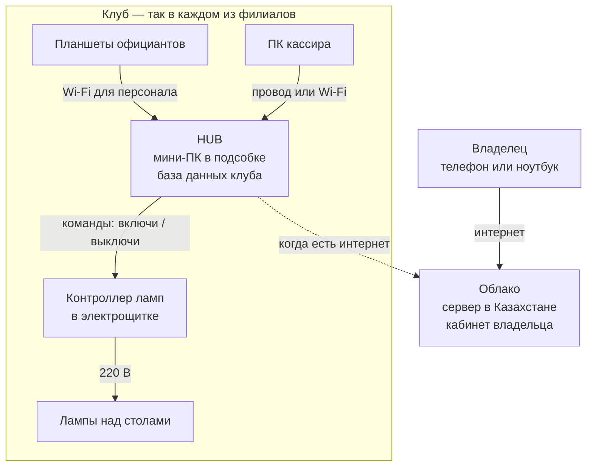
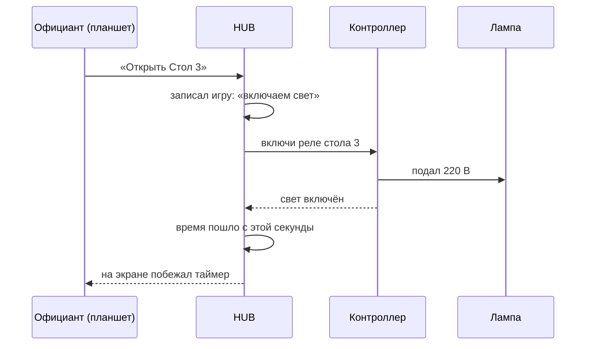
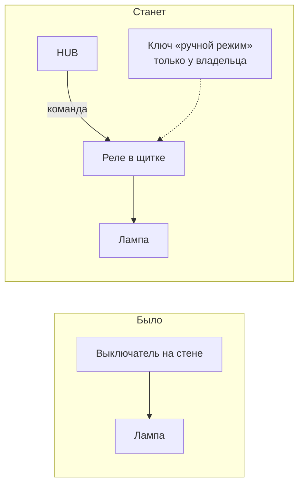

# Как всё устроено: железо, сеть, свет и данные

Объяснение для тех, кто не разбирается в компьютерах. Здесь описано, **на чём работает система billS, что купить, как подключить свет и где хранятся данные**.

> **Что уже работает, а что ещё в плане.** Программа HUB, экран зала, расчёт времени и денег, восстановление после перезапуска — готовы (этап 1). Настоящий контроллер ламп (этап 5), вход сотрудников по PIN (этап 3), облако владельца (этап 6), автоустановка и ночные копии (этап 8) — в плане. Там, где что-то ещё не сделано, в скобках указан этап из [README](../README.md).

---

## 1. Одной фразой

**В каждом клубе стоит маленький компьютер — HUB. Он управляет светом над столами и считает деньги. Сотрудники работают с ним через планшеты, а владелец видит все клубы через интернет.**

Четыре части, как у человека:

| Часть | На что похоже | Что это на самом деле |
|---|---|---|
| **HUB** | мозг клуба | мини-компьютер размером с книгу, стоит в подсобке. Помнит все игры, считает время и деньги, решает, когда включить свет |
| **Планшеты и касса** | пульты | обычные планшеты и ПК с браузером. Сами ничего не хранят — просто показывают экран HUB |
| **Контроллер ламп** | руки | блок с реле в электрощитке. По команде HUB включает и выключает свет над столами |
| **Облако** | окно владельца | сервер в интернете. Через него владелец из дома видит все свои клубы |

Главное правило: **клуб полностью работает без интернета.** Интернет нужен только владельцу, чтобы смотреть отчёты издалека.

---

## 2. Схема

Пунктир значит: связь с облаком может пропадать, и это не страшно. Клуб продолжит работать, а данные догонят облако позже.

---

## 3. Что происходит, когда официант нажимает «Открыть»

Важные мелочи:

- **Время начинает идти только когда свет реально включился.** Если контроллер не ответил, игра не начнётся и гости не заплатят за минуты, когда стол стоял тёмным.
- **«Стоп» останавливает время сразу**, в момент нажатия. Свет гаснет через долю секунды, но гости за эту задержку не платят.
- **Одна игра на стол.** Если два официанта нажмут «Открыть» одновременно, игра откроется одна, второй увидит «На столе уже идёт игра».

---

## 4. Что купить на один клуб

> Все цены — **ориентир на осень 2026, уточнить перед покупкой**. Цены в магазинах заметно скачут; ссылки — в конце документа.

| Что | Зачем | Требования | Ориентир цены |
|---|---|---|---|
| **Мини-ПК** для HUB | мозг клуба | процессор Intel N100 или новее, память 8–16 ГБ, диск SSD 256–512 ГБ, разъём для сетевого кабеля (Ethernet). Пример: DEXP Aquilon AQ02CY (16 ГБ / 512 ГБ) | около 16 тыс. ₽ в DNS России; в тенге смотреть на dns-shop.kz или kaspi.kz — примерно **90–130 тыс. ₸** |
| **ИБП** (бесперебойник) | чтобы HUB, роутер и контроллер не выключились при скачке или отключении света | 650–850 ВА, «линейно-интерактивный» | 650 ВА — от **19–20 тыс. ₸** (SVC, CyberPower); 850 ВА — от **22–25 тыс. ₸** (FSP) |
| **Контроллер ламп** | включает свет по команде HUB | готовый блок на DIN-рейку (крепится в щитке), ESP32 с сетевым кабелем или Modbus TCP, **по одному каналу на стол**: 8 каналов до 8 столов, 16 — до 16 | грубо **20–60 тыс. ₸**; точную модель выберем на этапе 5 |
| **Работа электрика** | поставить контроллер в щиток и провести линии ламп через реле | электрик с допуском; 220 В — только он | по договорённости |
| **Роутер** | связывает HUB, контроллер и планшеты | обычно уже есть. Нужно: отдельная Wi-Fi сеть для персонала и «постоянный адрес» для HUB (умеет почти любой роутер) | обычно 0 ₸ |
| **Планшеты** для официантов | открыть / остановить стол, заказы | любой простой Android-планшет или телефон с браузером | уточнить в магазине |
| **ПК кассира** | оплаты, смена, отчёты | подойдёт тот, что уже стоит на кассе — нужен только браузер | обычно 0 ₸ |
| **Флешка или внешний диск** | ночная копия базы | 32 ГБ и больше | несколько тысяч ₸ |
| **Датчики тока** (этап 5) | HUB видит, горит ли лампа на самом деле — защита от «света для друзей» | по одному на стол, подберём вместе с контроллером | уточним на этапе 5 |

**Итого на один клуб**: примерно **135–220 тыс. ₸** без планшетов и работы электрика. На 4 клуба — в 4 раза больше, облако одно на всех.

> **Для тестового стенда** (проверить систему на столе в офисе) хватит дешёвого модуля реле на 8 каналов за 2 500–3 000 ₸ и платы ESP32 от 2 200 ₸. **В клуб такое ставить нельзя**: это детали для самоделок, без корпуса и защиты.

---

## 5. Свет и электрика — простыми словами

**Было:** выключатель на стене → лампа. Кто угодно может включить свет.

**Станет:** реле в щитке → лампа. Включить свет может **только HUB**, когда открыта игра.

Что для этого делает электрик:

1. Ставит контроллер с реле в электрощиток (на DIN-рейку, как обычный автомат).
2. Ведёт линию каждой лампы через своё реле: стол 1 — реле 1, стол 2 — реле 2 и так далее.
3. **Убирает настенные выключатели** (или отключает их). Иначе вся защита теряет смысл: свет можно будет включить мимо системы.
4. Ставит **ключ-переключатель «ручной режим»** — на случай, если сломается HUB или контроллер. Ключ хранят **только владелец или управляющий**. Каждый раз, когда включён ручной режим, это видно в системе (с этапа 5).
5. Проверяет каждый стол.

Важно:

- **220 В — только электрик.** Ни вы, ни мы своими руками в щиток не лезем.
- **Контроллер не гасит свет сам.** Если пропала связь с HUB или HUB перезагружается, реле остаются как были: идёт игра — свет горит. Потом HUB сверяет и досылает команды.

---

## 6. Сеть в клубе

- **HUB и контроллер подключаются к роутеру сетевым кабелем**, не по Wi-Fi: провод надёжнее.
- **У HUB постоянный адрес**, например `192.168.1.10`. На каждом планшете — закладка на этот адрес, открываешь и работаешь. Устанавливать приложение не нужно (по желанию его можно «добавить на главный экран» — будет выглядеть как приложение).
- **Отдельная Wi-Fi сеть для персонала** с паролем, который знают только сотрудники. Гости сидят в гостевом Wi-Fi и HUB не видят.
- **Интернет нужен только для связи с облаком.** Пропал интернет — столы, свет и касса работают как обычно.

---

## 7. Где хранятся данные

| Где | Что там лежит | Если это сломается |
|---|---|---|
| **HUB клуба** (один файл базы SQLite на диске мини-ПК) | всё рабочее: игры, счета, оплаты, смены, сотрудники, журнал «кто что сделал» | восстановить из последней копии на новый мини-ПК, примерно за час |
| **Облако** (база PostgreSQL на сервере в Казахстане) | копия данных всех клубов, компания, владельцы, отчёты, настройки | клубы продолжают работать; облако восстанавливается из своих копий и догоняет |
| **Планшеты и ПК кассира** | ничего (только вход в систему) | взять другой планшет и открыть адрес HUB |
| **Контроллер ламп** | только «какие реле сейчас включены» | HUB перешлёт нужное состояние сам |
| **GitHub** | только исходный код программы, **без данных клубов** | — |

### Копии (бэкапы): правило трёх мест

1. **Диск HUB** — основная база.
2. **Каждую ночь — копия на флешку или второй диск** в клубе (этап 8).
3. **Копия в облаке** (этап 6).

Если сгорит мини-ПК: ставим новый, загружаем последнюю копию — клуб снова работает. Потеряются в худшем случае данные с момента последней копии, а с облаком — почти ничего.

---

## 8. Облако для владельца (этап 6)

- **Что это:** арендованный сервер (VPS) с базой PostgreSQL. На нём кабинет владельца: все клубы на одном экране, выручка по клубам, столам и сотрудникам, загрузка столов по часам, тарифы, сотрудники.
- **Как попадают данные:** каждый клуб с первого дня складывает свои события в очередь «на отправку». Когда есть интернет, облако забирает их; настройки (тарифы, сотрудники) идут обратно в клубы.
- **Где разместить: у хостинга в Казахстане.** Закон РК № 94-V «О персональных данных и их защите» требует хранить персональные данные (имена и телефоны сотрудников, гостей) в базе на территории Республики Казахстан. **Сверить с юристом** перед запуском.
- **Провайдеры** (примеры, не реклама): Hoster.kz — от ~3 100 ₸ в месяц, PS.kz, Oblako.kz — от ~7 160 ₸ в месяц.
- **Какой сервер нужен:** для старта хватит 2 ядра / 4 ГБ памяти — ориентир **5–10 тыс. ₸ в месяц**. Когда клубов и данных станет больше — 4 ядра / 8 ГБ, примерно **8–15 тыс. ₸ в месяц**.
- **Адрес:** свой домен (например, `billiard-control.kz`) и защищённое соединение HTTPS (замочек в браузере).
- **Одно облако на всю сеть клубов**, а не на каждый клуб.

---

## 9. Что будет, если…

| Ситуация | Что произойдёт | Что делать |
|---|---|---|
| **Пропал интернет** | Клуб работает полностью: столы, свет, касса. Владелец временно не видит свежие цифры | Ничего. Интернет вернётся — облако догонит само |
| **Отключили электричество** | Лампы гаснут — они от общей сети. HUB, роутер и контроллер работают от ИБП 15–30 минут. Время игр в HUB продолжает идти | **Решить правило** (см. раздел 15): ставить ли игры на паузу автоматически, когда ИБП сообщает об отключении (этап 5). Пока это не сделано — кассир останавливает игры вручную и открывает заново |
| **Света нет дольше, чем держит ИБП** | HUB выключится. База не испортится: она устроена так, чтобы переживать резкое выключение | После включения HUB сам запустится (этап 8), восстановит игры и вернёт свет на нужные столы |
| **Сломался HUB** | Через систему нельзя открыть и закрыть стол | Включить ключом ручной режим и временно вести учёт в тетради. Поставить новый мини-ПК и восстановить базу из копии, около часа |
| **Сломался или потерялся планшет** | Ничего не теряется — на планшете нет данных | Взять другой, открыть адрес HUB. За потерянный — сменить пароль Wi-Fi персонала и PIN сотрудника |
| **Завис контроллер ламп** | Свет остаётся как был. HUB видит, что контроллер молчит, и показывает тревогу. Новые игры не начнутся — время не пойдёт без подтверждения света | Выключить и включить автомат контроллера в щитке. HUB сам перешлёт нужное состояние. Не помогло — ручной режим |
| **Кто-то включил свет «для своих»** | Без настенных выключателей это можно сделать только ключом ручного режима. С датчиками тока HUB увидит «свет горит без игры» и сообщит владельцу (этап 5) | Посмотреть журнал: кто был на смене, кто включал ручной режим |
| **Официант не нажал «Открыть», а гости хотят играть** | Света нет — в темноте не поиграешь. В этом и смысл: **свет = оплачиваемое время** | — |
| **HUB перезагрузился во время игры** | Игры считаются с настоящего начала, свет возвращается на нужные столы. Это уже проверено тестами | Ничего |
| **Два официанта одновременно открыли один стол** | Откроется одна игра, второй увидит «На столе уже идёт игра» | Ничего |

---

## 10. Как пройдёт установка в клубе

1. **Подготовка, за неделю.** Владелец даёт: список столов (пул, русский, снукер), тарифы (цены по времени суток и дням), список сотрудников и их роли. Покупаем железо. Электрик смотрит щиток.
2. **День 1, утро (клуб закрыт).** Электрик ставит контроллер в щиток, ведёт лампы через реле, ставит ключ ручного режима, убирает настенные выключатели. Проверка: каждый стол включается в ручном режиме.
3. **День 1, после обеда.** Ставим мини-ПК и ИБП, подключаем к роутеру кабелем, устанавливаем HUB, вносим столы, тарифы и сотрудников, привязываем каждый стол к своему реле. **Проверка по каждому столу:** «Открыть» → свет загорелся → побежал таймер → «Стоп» → свет погас.
4. **День 2.** Обучение персонала — около 30 минут: открыть стол, остановить, принять оплату, открыть и закрыть смену. Первая смена — **система и тетрадь параллельно**.
5. **Первая неделя.** Каждый вечер сверяем выручку в системе с кассой, поправляем тарифы. Всё сходится — тетрадь убираем.

---

## 11. Обновления программы

- Новая версия ставится **ночью, когда клуб закрыт**, или в момент, когда нет идущих игр (этап 8).
- **Перед обновлением автоматически делается копия базы.**
- Если что-то пошло не так — **откат на прошлую версию за несколько минут**.
- **Данные не теряются**: база меняется аккуратными шагами (это называется «миграции»), старые записи остаются.

---

## 12. Безопасность

- **У каждого сотрудника свой PIN** и свои права (этап 3): официант не может сделать возврат, кассир не может поменять тарифы.
- **Журнал действий**: каждое нажатие записывается — кто, что, когда. Удалить запись из журнала нельзя.
- **HUB не открыт в интернет.** Он сам «звонит» в облако, а снаружи к нему подключиться нельзя.
- **Удалённая поддержка** — через защищённый канал (WireGuard или Tailscale), без открытия «дырок» в роутере (этап 8).
- **Облако — только через HTTPS** (замочек в браузере).
- **Копии базы шифруются**: даже если флешку украдут, данные не прочитать.

---

## 13. Какая операционная система на HUB

**Рекомендация: Linux (Ubuntu Server LTS).**

- Работает годами без перезагрузок.
- **Не перезагружается сам ради обновлений посреди вечера**, как это любит Windows.
- Бесплатный.
- Сотрудники клуба с ним вообще не сталкиваются — HUB стоит в подсобке без монитора.

**Windows тоже подойдёт** (программа одинаково работает на обоих), но тогда нужно настроить «часы обновлений», чтобы Windows не перезагружалась в рабочее время.

---

## 14. Сколько это стоит (ориентиры)

| | Сумма | Примечание |
|---|---|---|
| **Разово на один клуб** | ~135–220 тыс. ₸ | мини-ПК, ИБП, контроллер, флешка. **Плюс** планшеты и работа электрика |
| **Разово на 4 клуба** | ~540–880 тыс. ₸ | то же × 4 |
| **Облако, в месяц** | ~5–10 тыс. ₸ на старте, 8–15 тыс. ₸ позже | одно на всю сеть клубов |
| **Домен, в год** | небольшая сумма | адрес кабинета владельца |
| **Электричество HUB** | почти ноль | мини-ПК потребляет как лампочка |

---

## 15. Что нужно решить владельцу

1. **ОС на HUB:** Linux (рекомендуем) или Windows?
2. **Отключение электричества:** ставить игры на паузу автоматически, когда пропало питание? Или время идёт, а решает управляющий?
3. **Стол после «Стоп»:** освобождать сразу (как сейчас — следующие гости могут играть, а счёт ждёт на кассе) или держать занятым до оплаты?
4. **Планшеты:** клубные (рекомендуем — проще контролировать) или телефоны сотрудников?
5. **Хостинг облака:** какой провайдер в Казахстане.
6. **Ключ ручного режима:** у кого он хранится в каждом клубе?

---

## 16. Словарик

| Слово | Что значит |
|---|---|
| **HUB** | мини-компьютер в клубе, на котором работает программа. Мозг клуба |
| **Облако** | сервер в интернете, где собираются данные всех клубов для владельца |
| **VPS** | арендованный сервер в дата-центре — «компьютер в аренду», за который платят помесячно |
| **SQLite** | база данных в одном файле. Стоит в HUB, не требует настройки и обслуживания |
| **PostgreSQL** | большая база данных для облака, где хранятся данные всех клубов |
| **Реле** | выключатель, которым управляет электроника вместо руки |
| **Контроллер** | блок в щитке с несколькими реле, получает команды от HUB по сети |
| **ИБП** | бесперебойник: аккумулятор, который держит технику включённой при отключении света |
| **PWA** | сайт, который можно «добавить на главный экран» планшета — выглядит и открывается как приложение |
| **Бэкап** | резервная копия базы на случай поломки |
| **Миграция** | аккуратное изменение структуры базы при обновлении программы, без потери данных |

---

## 17. Источники цен и требований

Цены собраны в октябре 2026 и меняются — перед покупкой проверьте актуальные.

- Мини-ПК: [DEXP Aquilon AQ02CY в DNS (Россия)](https://www.dns-shop.ru/product/ef6d2859e958492e/mini-pk-dexp-aquilon-aq02cy/), [неттопы и мини-ПК в DNS Казахстан](https://www.dns-shop.kz/catalog/recipe/c2e1463e83146887/nettopy-i-mini-pk/)
- ИБП: [FSP FP 850 на e-katalog.kz](https://e-katalog.kz/FSP-FP-850.htm), [ИБП 650 ВА на forcecom.kz](https://forcecom.kz/catalog/ups/filter/ups_output_va-from-650-to-700/), [ИБП 650 ВА на otvertka.kz](https://otvertka.kz/category/ups/ibp-650va)
- Модули для стенда: [модуль реле 8 каналов на ba3ar.kz](https://ba3ar.kz/product/modul-rele-na-8-kanalov), [модуль реле 8 каналов в Arduino Parts](https://arduino-parts.kz/p103768813-modul-rele-kanalov.html), [ESP32 на satu.kz](https://satu.kz/Esp-32.html)
- Облако: [Hoster.kz — VPS от 3 100 ₸](https://www.clex.kz/news/hosterkz-predlagaet-vps-v-kazahstane-ot-3-100-s-besplatnym-testom-na-7-dney), [Oblako.kz — VPS](https://oblako.kz/products/vds-server), [обзор VPS в Казахстане 2026 на DTF](https://dtf.ru/ruslan-titov/4953799-arenda-vps-i-vydelennykh-serverov-v-kazakhstane)
- Хранение персональных данных в РК: [памятка Deloitte о защите персональных данных](https://www2.deloitte.com/content/dam/Deloitte/kz/Documents/legal/LegalAlert/KZ_Personal%20data%20protection_ru.pdf), [статья «Параграф» о требовании локализации баз данных](https://prg.kz/pravmedia/7773-trebovanie-po-mestnoy-lokalizacii-baz-dannyh-neobhodimaya-mera-ili-prevyshenie-yurisdikcii.html)
